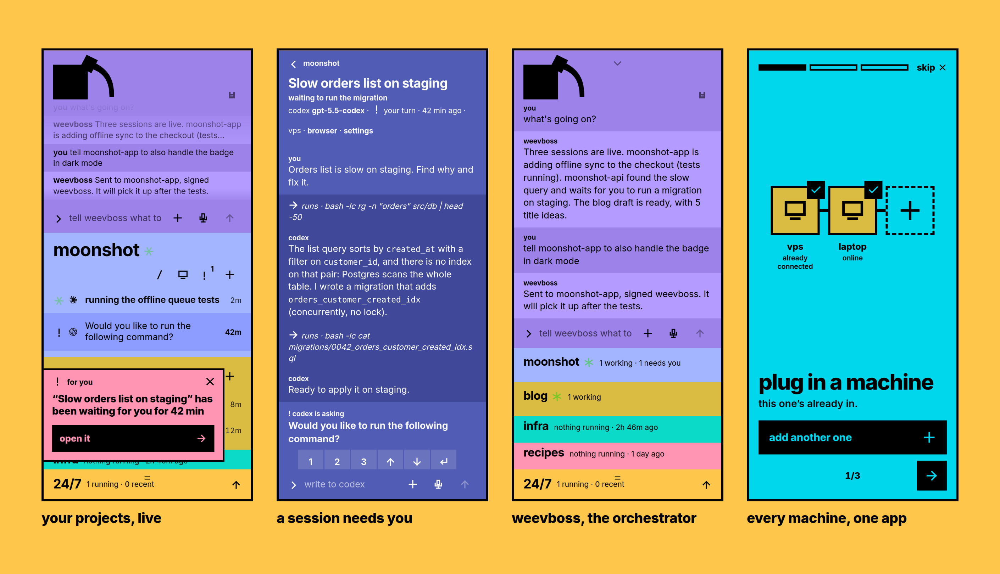

# weevils

**A phone cockpit for your coding agents**: see and drive your Claude Code and Codex sessions, on one or more
machines, from your phone.

- **Every session, sorted by project**: live state (working, your turn, available, done), what the agent is doing
  now, and the full thread, read straight from the Claude Code / Codex transcripts.
- **Drive them from the phone**: write to a session, answer its permission prompts with one tap, start a new one,
  resume a closed one, send photos, dictate.
- **weevboss**, the orchestrator at the top: a dedicated Claude session you talk to; it reads the other sessions and
  dispatches work to them.
- **Several machines, one app**: each machine runs a small daemon; secondary machines join the main one through a
  reverse SSH tunnel.
- **Your subscriptions, no API cost**: weevils drives the official `claude` and `codex` CLIs you are already logged
  in to. A Node 22 server with no runtime dependency, an installable web app (PWA), English and French.



## Install

On a Linux machine or VPS (Ubuntu/Debian tested; dnf and pacman supported). You need Claude Code and/or Codex
installed and logged in there; the installer takes care of the rest (git, tmux, Node.js ≥ 22.18…, with sudo after
asking).

```sh
git clone https://github.com/Sc4rville/weevils && cd weevils && ./install.sh
```

Once the repo is public, a one-liner will do the same:

```sh
curl -fsSL https://raw.githubusercontent.com/Sc4rville/weevils/main/install.sh | bash
```

Run it again any time: it updates and keeps your settings.

| option | |
|---|---|
| `--yes` | no questions, defaults everywhere |
| `--name <first name>` | how the agents call you |
| `--lang en\|fr` | language of the installer and of the server |
| `--domain <host>` | HTTPS through Caddy (the domain must point to the machine, ports 80/443 open) |
| `--port <n>` | port of weevilsd on 127.0.0.1 (default 4179) |
| `--dir <path>` | install directory when piped from curl (default `~/weevils`) |
| `--secondary <ssh-host>` | install a secondary machine federated to the main one |
| `--machine <id>` | id and name of this machine (default: hostname) |
| `--no-update` | no `git pull` |

**HTTPS.** With `--domain weevils.example.com`, the installer sets up Caddy and a site for weevilsd (an existing
Caddyfile keeps its sites). Without it, weevilsd only listens on 127.0.0.1: reach it through an SSH tunnel
(`ssh -L 4179:127.0.0.1:4179 you@server`, then http://localhost:4179), or set `WEEVILS_HOST=0.0.0.0` to open it to
your LAN over plain http. Push notifications and the installed app need HTTPS.

**A second machine** (a laptop, another server): install the main machine first, make sure `ssh <main host>` works
without a password from the second one, then run there:

```sh
./install.sh --secondary <main ssh host>
```

It runs its own weevilsd (no app, no weevboss) and a reverse SSH tunnel to the main machine, registers itself
there, and its sessions show up in the main app.

Under the hood, `install.sh` calls `server/install.sh main` or `server/install.sh secondary <ssh-host>`, which
install the commands in `~/.local/bin` (`wv`, `weevils`, `weevils-service`, `weevils-hook`), the Claude Code hooks
and the service (`systemd --user` with linger, or a background process where there is no systemd). Control it with
`weevils-service start|stop|restart|status|logs`. (`server/install.sh pc` is a deprecated alias of `secondary`.)

All the details, what the script changes and how it is tested: [docs/install.md](docs/install.md).

## First run

1. The installer prints the address, the **access code**, a login link (`https://<your domain>/#k=<code>`) and its
   QR code. Scan it with your phone: you are logged in. The code is in `~/.config/weevils/secret` if you need it
   again.
2. **Add it to the home screen** (iPhone: Safari → Share → Add to Home Screen; Android: Chrome → Install app). On
   iPhone the installed app asks for the code once more (it has its own cookies), then notifications can be turned on.
3. The **onboarding** (three cards: a machine, a session, weevboss) shows on an empty feed; replay it from the
   settings in the bottom band.
4. Start sessions with **`wv`** so weevils can drive them: `wv` (claude in the current folder), `wv "first message"`,
   `wv codex`, `wv ls`, `wv a` (attach). Or tap `+` in a project, or just ask weevboss. Sessions opened in a plain
   terminal can't be written to safely, so they are hidden.

Requests coming from the machine itself (127.0.0.1, no proxy) are trusted without a code: that is how `weevils`
(the command weevboss uses) talks to weevilsd, and how the main machine reaches a secondary one through its tunnel. Anyone with the code can type into your
agents, which is shell access: keep it secret.

## Configuration

One file, outside the repo: `~/.config/weevils/env` (`NAME=value`, one per line), created by the installer from
[`weevils.env.example`](weevils.env.example), which documents every key. After a change: `weevils-service restart`.

| key | |
|---|---|
| `WEEVILS_USER_NAME` | your first name, for the agents |
| `WEEVILS_LANG` | `en` or `fr` for what the server writes (the app follows the browser) |
| `WEEVILS_PUBLIC_URL` | public address of the app (push notifications, login link) |
| `WEEVILS_PORT`, `WEEVILS_HOOK_PORT`, `WEEVILS_HOST` | app port (4179), local hook port (4180), listen address (127.0.0.1) |
| `WEEVILS_PROJECTS` | folders holding your repos, `:`-separated (default `~/projects`) |
| `WEEVILS_EXPOSE_DOMAIN` | domain where preview servers are exposed as `<name>.<domain>` (built-in browser) |
| `WEEVILS_GH_OWNER` | GitHub account of your repos (default: the one `gh` is logged in with) |
| `WEEVILS_MACHINE`, `WEEVILS_MACHINE_NAME` | id and display name of this machine (default: hostname) |
| `WEEVILS_ORCHESTRATOR` | `1` on the main machine (weevboss), `0` on a secondary one |
| `WEEVILS_REMOTES` | other weevilsd to federate, `name=url,…` (filled in by `--secondary`) |
| `OPENAI_API_KEY`, `CARTESIA_API_KEY` | dictation and spoken summaries; voice (otherwise edge-tts) |
| `DEVIL_API_URL`, `DEVIL_API_KEY`, `DEVIL_MODEL` | devil mode: another model behind an OpenAI-compatible API |
| `WEEVILS_AUTHOR_<ID>`, `WEEVILS_MAIL_*` | external authors and the e-mail bridge (below) |

### E-mail bridge (external agents)

Agents other than weevboss can write to the sessions by e-mail. Each one is an **author** declared in the env file
(`WEEVILS_AUTHOR_<ID>=name | color | e-mails | secret`); its messages show in the threads signed with its name, in
its color.

- **Address**: an alias of your Gmail inbox, `you+weevils@gmail.com` (`WEEVILS_MAIL_ADDRESS`, app password in
  `WEEVILS_MAIL_PASSWORD`), which receives and replies (as From). A Gmail filter "to: you+weevils@gmail.com" applies
  the `weevils` label and skips the inbox; the bridge only watches that label (never INBOX), only handles mail sent
  to the alias, and never reads, marks, moves or deletes any other mail.
- **Subject = target**: `[project]` an available session of the project (otherwise a new one) ·
  `[session:2cbb0bbd]` that session · `[weevboss]` the orchestrator · `[new:project]` (or `[new:project:codex]`) a
  new session. **Body** = the message.
- **Reply**: sent back to the sender in the same thread (In-Reply-To); answering it continues the same session.
- **Delivery**: IMAP IDLE (push), re-armed every 30 s (fallback polling), automatic reconnection, dedup by
  Message-ID. Log: `journalctl --user -u weevilsd | grep '\[mail\]'`.
- **Security**: only declared senders get through, with SPF or DKIM aligned on their domain (Authentication-Results
  of the receiving server) or the author's secret (`[key:…]` in the subject, or a `key: …` line in the body). Rate
  limit per author. Everything else is ignored, logged, and left unread.
- **No loops**: nothing from the bridge's own address, nothing automatic (Auto-Submitted, X-Autoreply,
  Precedence: bulk, X-Weevils); every reply goes to the sender only and carries `Auto-Submitted: auto-replied` and
  `X-Weevils`.

## Architecture

```
phone (PWA) ──HTTPS + SSE──▶ Caddy (optional) ──▶ weevilsd :4179 (main machine, Node 22, no dependency)
                                                    ├─ Claude Code / Codex transcripts (~/.claude, ~/.codex)
                                                    ├─ Claude Code hooks: exact live state (127.0.0.1:4180)
                                                    ├─ tmux sessions "wv-*": write, read the screen, keys
                                                    ├─ weevboss: a Claude session with the `weevils` command
                                                    └─ other machines' weevilsd, via reverse SSH tunnel (127.0.0.1:4192…)
```

- **`server/`**: weevilsd. Reads the transcripts incrementally, receives the hooks, drives tmux, imports ChatGPT /
  Claude.ai exports (`~/weevils-imports`), sorts sessions (folder → repo → project, where a project is a family of
  repos sharing a prefix: `shop-web`, `shop-api` → `shop`), serves the app and the API.
- **`src/`**: the React app (Vite, Motion). **`shared/`**: types and i18n shared by both.
- **Machines**: every machine runs its own weevilsd; the main one federates the others (`WEEVILS_REMOTES`) and is
  the only one serving the app and running weevboss.

## Development

```sh
npm install
npm run dev          # Vite on 127.0.0.1:4178 with HMR, proxies /api to a weevilsd on :4179
npm test             # vitest (includes the i18n test)
npm run typecheck    # app; the server: npx tsc --noEmit -p server
npm run i18n:check   # no hard-coded user-facing string
npm run build        # what weevilsd serves (dist/)
test/docker/run.sh   # installer end to end in blank Ubuntu containers (needs Docker); `edge` for the hard cases
```

Run a throwaway weevilsd next to a real one with its own home, tmux server and ports, no federation and no weevboss
(it serves `dist/`, so `npm run build` first):
`T=$(mktemp -d); env -u WEEVILS_REMOTES HOME=$T TMUX_TMPDIR=$T WEEVILS_PORT=4410 WEEVILS_HOOK_PORT=4411 WEEVILS_ORCHESTRATOR=0 node server/index.ts`.
`/phones.html` shows the app at 375 / 390 / 430 px side by side.

## Languages

English and French, everywhere: the app follows the browser (setting in the bottom band), the server uses
`WEEVILS_LANG` (or the app's choice), the installer `--lang`.

Every area owns a small catalog with both languages side by side, same keys, checked by TypeScript:
`src/i18n/<area>.ts` for the app, `server/i18n/<area>.ts` for the server. To add a language: add it to `Lang`,
`LANGS` and `LANG_NAMES` in [`shared/i18n.ts`](shared/i18n.ts), then a block in every catalog; the shell parts
(`install.sh`, `server/wv`, `server/weevils-cli`) and weevboss's prompt (`server/orchestrator.<lang>.md`) have their
own strings.

## More

- [docs/install.md](docs/install.md): installer details and tests
- [docs/vision.md](docs/vision.md): design rules · [docs/decisions.md](docs/decisions.md): provisional choices
- [docs/plan.md](docs/plan.md): the original plan · [docs/changelog.md](docs/changelog.md): what changed since
- `harness-interface-kit/`: the original French design brief the prototype was built from

## License

License: TBD (no license file yet).
