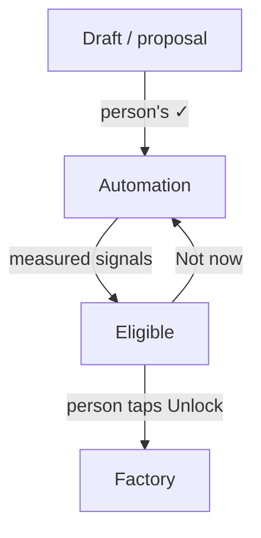

# Autonomous: automations and factories

The protocol for everything in weevils that runs on its own. It is shared product behaviour: the same for Claude and
Codex, for every installation, in every theme and both languages. It names what already exists, adds what was
missing, and fixes the conventions. Where this page and the code disagree, this page changes first, once, and the
code follows.

Related: [automation software lifecycle](../product/automation-software.md) (source adoption, pins, deletion),
[what merges on its own](auto-merge.md), the playbooks beside this file (`night-lens.md`, `repo-hygienist.md`).

## 1. Words

| Word | Meaning |
|---|---|
| **Autonomous** | The section of the app that lists what runs on its own. It replaces the label « Automations ». |
| **Automation** | A job the person approved once, that then runs by itself inside its rules (its *standing authorization*). |
| **Factory** | An automation that graduated: its own private GitHub repository, its own icon, its own page. |
| **Mother** | The folder `<projects>/automations/` that holds every automation's source. |
| **Unlock** | The person's tap that turns an automation into a factory. Nothing else can. |

Internal names stay as they are (`Optimizer`, `/api/optimizers`, `/api/auto`, `h24`, `auto/…` branches): renaming
them would break running installs for no gain. Only what a person reads changes.

## 2. What exists, what this adds

| Area | Already there (kept) | Added by this protocol |
|---|---|---|
| Source | One local Git repository per automation, a registry, pinned snapshots that actually run | A human `name`, a manifest that says what the automation is (schema 2) |
| Rules | The scheduler's record: schedule, scope, target, pause; jail and deny list | A read-only mirror of them in the manifest; the rule that the mirror never drives |
| Runs | Report file, last words, changed files, links, images, archive per run | An optional run card (`run.json`): a summary line, numbers, results |
| Results | Branch + auto-merge or « Land it »; weevils pages; For you posts; the « Automation results » page | A declared results page per automation, opened from its page |
| Lifecycle | Draft → proposal → accepted → runs; pause; delete keeps the work | Eligible → unlocked → factory |
| App | The automations drawer (classic), the Automations section (next), one page per automation | The label « Autonomous », the factory icon, the factory page, the unlock moment |

## 3. The mother folder

```
<projects>/automations/              the mother (marker: .weevils-owner.json)
  README.md                          what this folder is, for a stranger (written once, yours to edit)
  registry/                          a Git repository: one small file per automation (id → folder, kind, name)
    automations/<id>.json
  projects/auto-<id>/                one Git repository per automation, with its history from day one
  .versions/<id>/<commit>/           read-only snapshots: the exact source a run executes
```

- The folder name stays `auto-<id>`: the id never changes, so a rename of the automation breaks nothing. The human
  name lives in the manifest and in the registry.
- The mother itself is not a Git repository and there are no submodules (unchanged). Each automation being its own
  repository is what lets a factory leave later **with its whole history**, with no rewrite.
- Nothing here has a remote until a factory is unlocked (section 9).

## 4. One automation = one small repository

```
automation.json        the manifest (section 5)
README.md              what it is, for a stranger
PLAYBOOK.md            optional: the method the agent follows on every run
src/run.mjs            the entrypoint; the scheduler runs `node src/run.mjs -- <provider command>`
src/*.test.mjs         its tests: `node --test src/`
config.example.json    the names of its parameters, never their values
.gitignore             state/, outputs/, .env*, *.log, node_modules/
```

- **Never in Git:** secrets, local paths, host names, run outputs, conversation text, the private brief.
- **The method is versioned, the brief is a pointer.** A method worth keeping lives in `PLAYBOOK.md`, or in the
  project the automation works on (`docs/automations/<name>.md`) when the method is about that project. The stored
  brief then only says « read your playbook ». Changing the method is a commit.
- **The entrypoint may grow.** It starts as a plain adapter that passes the agent's command through. It can take
  over deterministic steps (decide a quiet night, publish a file once). Only a committed revision is ever run.
- Commits: `type(scope): what and why`, as everywhere in weevils.

## 5. The manifest (`automation.json`, schema 2)

```json
{
  "schemaVersion": 2,
  "id": "a1b2c3d4e5",
  "kind": "automation",
  "name": "night-lens",
  "title": "Night lens",
  "purpose": "Looks at the app every night as a newcomer would and proposes what to simplify.",
  "owner": { "repo": "my-app" },
  "schedule": { "trigger": "sleep", "every": "24h", "window": "01:00-05:00" },
  "scope": "Readability fixes and proposals for the app; nothing published outside this machine.",
  "entrypoint": "src/run.mjs",
  "steps": [{ "id": "agent-task", "type": "agent", "instructions": { "configuration": "optimizer", "id": "a1b2c3d4e5", "field": "prompt" }, "target": { "configuration": "optimizer", "id": "a1b2c3d4e5", "field": "repo" } }],
  "playbook": { "in": "owner", "path": "docs/automations/night-lens.md" },
  "results": { "page": "report/night-lens" },
  "metrics": [{ "key": "proposals", "label": "Proposals" }],
  "runtime": { "configuration": "installation", "state": "outside-source", "secrets": "references-only" }
}
```

| Field | Meaning | Written by |
|---|---|---|
| `id` | Stable identity, never reused | weevils, once |
| `kind` | `automation` or `factory` | weevils (unlock) |
| `name` | Lowercase slug, unique in the mother; a factory's repository name | weevils, from the title; kept when the title changes |
| `title`, `purpose` | What the person reads: its name, its job in one sentence | mirror of the scheduler's record |
| `owner` | The repository it works in; `null`: its own workspace | mirror |
| `schedule` | `trigger`: `every`, `window`, `time`, `idle`, `sleep`; `every` (`3h`, `24h`, `7d`); `window` (`HH:MM-HH:MM`); `at` (ISO date) | mirror |
| `scope` | The standing authorization, one plain sentence | mirror |
| `entrypoint`, `steps`, `runtime` | Unchanged from schema 1 | weevils / the source's author |
| `playbook` | Where the method is: `{ "in": "source" \| "owner", "path" }` | the source's author |
| `results` | `page`: the weevils page its results live on (`<kind>/<slug>`) | the source's author, or weevils when a run publishes one |
| `metrics` | The numbers its runs report: `key`, `label` (a string, or `{ "en", "fr" }`) | the source's author |
| `factory`, `page` | Factories only (sections 9 and 11) | weevils (unlock), then the source's author |

**The mirror never drives.** The schedule, the scope, the target and the pause live in the scheduler's record
(private installation storage) and change only through the app: a talk, then the person's ✓. weevils copies them
into the manifest so the repository says what it is. An edit of `title`, `purpose`, `owner`, `schedule` or `scope`
in Git changes nothing that runs, and the next sync writes the live values back. No commit, by anyone, can widen an
authorization or move a schedule.

Unknown fields are kept and ignored. A schema 1 manifest still runs (section 12).

## 6. How a run reports

A run leaves, beside its work (never inside the branch):

| What | Where | Read as |
|---|---|---|
| The report | the report file named in its brief (`<id>.md` beside the worktree, or `report.md` in its workspace) | prose; its first line is the headline |
| The run card (new, optional) | `<id>.run.json` beside the report (`run.json` in a workspace) | `{ "summary": "one line", "metrics": { "proposals": 3 }, "page": "report/night-lens" }` |
| Its last words | the session's last message | fallback headline |
| Its changes | the diff of its branch since the run started | files, +/− |
| Links and images | found in the report and the last words; images copied (6 at most) | the run's page |

- `ok` is the scheduler's verdict (the entrypoint's exit status and the supervisor), never the report's own claim.
- `metrics` are numbers only, keyed as declared in the manifest; undeclared keys are kept but not shown.
- weevils stores the summary, the numbers and the page on the run's line. A run with no card is a normal run.
- A run never says its work is live: weevils says so itself when it landed.

## 7. How results land

1. **Work on a repository** goes to the automation's own branch (`auto/<slug>-<id>`), pushed by weevils. Inside its
   scope and green, it lands on main by itself; otherwise one line in For you with **Land it**
   ([auto-merge.md](auto-merge.md)).
2. **Something to look at** (leads, a report, a library) lives on a weevils page with a stable title and kind, so its
   address never moves: `weevils page <file|folder> "<title>" --kind <kind>`. The manifest names it in
   `results.page`; the automation's page opens it with one living link.
3. **Something to say**: at most one For you post per run, only when it is worth reading, with honest evidence flags
   (`--demonstrated`, `--verified`, `--limit`). Buttons only for what stays the person's call.
4. **The history** of every run stays on the « Automation results » page.

## 8. From automation to factory



### Signals (measured, per automation)

| Signal | What is counted | Source |
|---|---|---|
| Runs | Completed runs; how many of the last 10 succeeded | scheduler (exists) |
| Age | Days since it was accepted | scheduler (exists) |
| Consumed | Opens of its page, of one of its runs, of its results page; taps on its For you cards | usage counters (new), per day |
| Pushes | « Run now » taps; messages the person wrote to it after accepting it; runs the person took over | counters (new) + talk and runs (exist) |
| Requests | Requests in weevboss's ledger that name it, or were sent to one of its sessions | ledger (exists) |
| Growth | Commits someone made to its source (never weevils' own manifest commits); a results page | its repository (exists) |

Counters are whole numbers per day, kept 60 days, stored with the scheduler's state. Only a signed-in browser
counts as the person: agents, scripts and weevboss never add to them.

### Eligible = mature, and one more reason

**Mature** (all of): accepted, recurring, not built into the server, not paused, source ready; **10 runs or more**;
accepted **7 days ago or more**; **8 of its last 10 runs** succeeded.

**And one of**, over the last 30 days:

| Reason | Rule |
|---|---|
| **Used** | 12 or more consumptions, on 4 different days or more |
| **Pushed** | 5 or more pushes, or 3 or more requests |
| **Proven** | 30 runs or more with 9 of the last 10 succeeded, or a source that grew (3 commits or more of its own) with a results page |

The numbers are constants in one file (`shared/factory.ts`), tested, and shown with the reasons: the proposal always
says *why* in one clause (« 37 runs, 29 of the last 30 succeeded »). No score, no hidden weighting.

### Where the proposal shows (two places, nowhere else)

1. **One short line from weevboss**, once, in For you: « *Opportunity hunter* can become a factory: 37 runs, 10 of
   the last 10 good. » A tap opens the automation. The line itself unlocks nothing.
2. **A quiet line on the automation's own page**, under its facts, while it is eligible: « Ready to become a
   factory », with the reason. A tap unfolds what the unlock does and its two answers, **Unlock** and **Not now**.
   No badge in the list, no counter, no progress bar.

Pace: one proposal at a time for the whole installation, one new proposal a week at most. **Not now** hides both
places for that automation for 30 days and until it has 10 more runs. After three « Not now », weevboss stays
silent about it for good; the quiet line on its page comes back when it is eligible again.

### Unlock

- Only the person's own tap (a signed-in browser). An agent, a script or weevboss calling the same route is refused.
- Above the button, one sentence says all it does: « Its own private repository, its own icon, its own page. Its
  schedule and its rules stay exactly as they are. »
- **The moment** (about a second, once, on the device that unlocked): the page becomes the factory's own, the loop
  icon fades as the factory's outline draws itself over it, and one line reads « *Opportunity hunter* is now a
  factory ». No confetti, no sound, no modal. With reduced motion: the icon is the factory, the line is there.
- Unlocking never starts a run, never changes the schedule, the scope, the target, the pause or the pinned source.

## 9. What unlocking does (the split)

Each step is recorded and can be resumed; a failure leaves the automation running exactly as before.

1. **Check**: the source tree is clean; the name is free; no secret pattern in its files or its history (private
   keys, tokens, `.env`): a hit stops here and says so.
2. **Mark**: the manifest gets `"kind": "factory"` and `"factory": { "name", "unlockedAt" }`, in one commit
   (`feat(factory): <name> becomes a factory`). The entrypoint is untouched.
3. **Repository**, when GitHub is connected: `gh repo create <owner>/<name> --private --description "<purpose>"`,
   topics `weevils`, `factory`, `automation` and the owner project's name; `origin` is added; `main` is pushed with
   its **whole history**. Never forced, never over an existing repository: a taken name becomes `<name>-factory`.
   `<owner>` is the installation's GitHub owner (`WEEVILS_GH_OWNER`, else the signed-in account).
4. **Register**: the registry entry gets `kind`, `name` and the remote.
5. **Later commits**: weevils pushes the factory's `main` when a new revision is selected. Runs stay in their jail,
   with no GitHub credential, as before.

No GitHub yet: the factory is unlocked locally (icon, page) and step 3 waits, shown as one line on its page
(« repository: waiting for GitHub »). Deleting a factory keeps its repository, local and remote.

## 10. Icons

One grid (24 × 24), one stroke (2.5), square ends, no curves, no fill: the existing set.

| What | Icon | While it runs |
|---|---|---|
| Automation | `cycle`: the open square loop with its arrow head | `AutoMark`: a segment travels the loop, in `--auto-fluo` |
| Factory | `factory`: the same square body, with a saw-tooth roof and a chimney | `FactoryMark`: the same segment travels the factory's outline, same colour |

The factory keeps the loop's body: it is the same thing, grown up. It uses the existing theme tokens only (ink,
`--auto-fluo`) and the loop mark's own class, so it reads in every theme with no new colour and no rule of its own.
Outside the Autonomous section (a session's row, a project's name), anything that runs on its own keeps the one
loop mark: one sign for « this works by itself », two icons only where the two kinds are listed.

## 11. The factory page

An automation has the standard page. A factory **declares its own**, as data: the manifest lists panels, weevils
draws them with its own components. A factory never ships HTML, CSS, scripts or colours.

```json
"page": { "panels": [
  { "type": "hero" },
  { "type": "metrics", "items": [{ "key": "leads", "label": "Leads" }, { "key": "runs.ok" }] },
  { "type": "results", "limit": 5 },
  { "type": "chart", "metric": "leads" },
  { "type": "runs" },
  { "type": "actions", "items": [{ "do": "run" }, { "do": "conversation" }, { "label": "Tighten the filter", "ask": "Make Opportunity hunter stricter: …" }] }
] }
```

| Panel | Shows | Options |
|---|---|---|
| `hero` | Icon, name, purpose, the living link to its results | none |
| `facts` | Next run, schedule, last run, runs so far, where it works, its repository | `items` |
| `metrics` | Up to 4 numbers: the newest value and its change since the run before | `items`: `key`, `label` |
| `chart` | One number over the last runs, as flat bars | `metric`, `runs` (30 at most) |
| `results` | The newest runs' outcomes, one line each (the run card's summary); a tap opens the run | `limit` (10 at most) |
| `gallery` | The newest images its runs left | `limit` (6 at most) |
| `report` | The start of the newest run's report | none |
| `runs` | The strip of its runs; a tap opens one | none |
| `actions` | Up to 4 buttons: `do` (`run`, `pause`, `results`, `conversation`, `repository`) or `ask` (a brief sent to weevboss as the person's request) | `items` |
| `text` | A short note | `title`, `body` |

- Built-in numbers: `runs.total`, `runs.ok` (of the last 10), `runs.streak`, `tokens.total`. Others come from the
  run cards (section 6).
- At most 8 panels. An unknown panel or key is skipped, never an error. A label is a string or `{ "en", "fr" }`.
- No `page` in the manifest: the default factory page (`hero`, `metrics` with the built-in numbers, `facts` with
  its next run and its schedule, `results` or `report`, `runs`, `actions`).
- Same component in the classic app and in next (`src/ui/factory-page.tsx`). Nothing an automation can do is lost:
  its talk, its schedule and its delete stay on the standard page, one tap away (a head button in the classic app,
  the small flip in next).

## 12. Moving existing automations to schema 2

Additive, automatic, at server start, after source adoption:

- Only an adopted automation that is not running, with a clean source tree, is touched; the others wait.
- weevils adds the new fields to `automation.json` (name, title, purpose, owner, schedule, scope, and the results
  page when a run already published one) and commits (`chore(manifest): schema 2`). Nothing is removed.
- The pinned source moves to that commit **only when the commit changed nothing but the manifest and the README**
  (checked with Git): the code that runs is byte-identical.
- The scheduler's record is not modified: schedule, time zone, scope, pause, target, state, history and
  conversations are read, never written. A test compares them before and after.
- Going back: select the previous revision (`POST /api/auto/:id/source`); the existing adoption rollback still
  switches every automation to the legacy runner.

## 13. For agents (Claude and Codex)

- You never unlock, never propose a factory by yourself, never edit the mirrored fields to change behaviour.
- weevboss says the factory line only when the server reports an automation eligible, with the server's reason.
- In a run: write the report, and the run card when you have numbers; publish results on the declared page; one For
  you post at most; never push, never claim « live ».
- Changing an automation's method: commit to its playbook or its source, then select the revision. Changing its
  schedule or scope: a talk on its page, accepted by the person.

## 14. API (additions)

| Route | Does |
|---|---|
| `GET /api/auto/:id/signals` | The measured signals and whether it is eligible, with the reasons |
| `POST /api/auto/:id/seen` `{ what }` | Counts one consumption (`page`, `run`, `results`); a signed-in browser only |
| `POST /api/auto/:id/factory/unlock` | The unlock; the person only |
| `POST /api/auto/:id/factory/later` | « Not now » |

`Optimizer` gains `name`, `factory` (`{ name, unlockedAt, repository?, remote, panels? }`) and `promotion`
(`{ reasons }`, present only while eligible and not put off). `AutoRun` gains `summary`, `metrics`, `page`.
