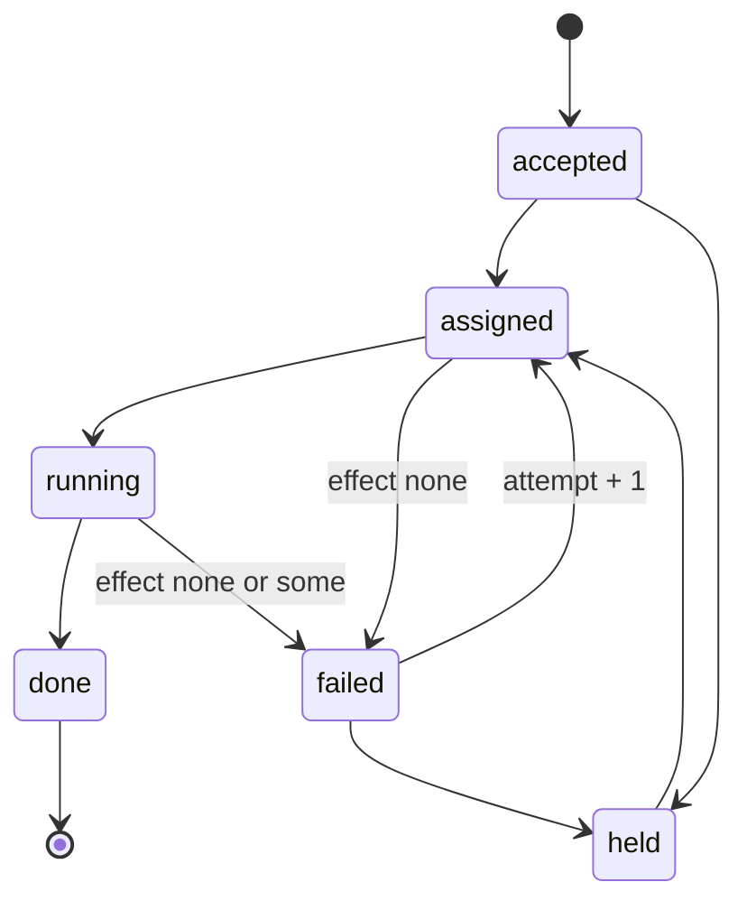

# 01 · Thread

A thread is one conversation, with an id that never changes. Its whole story is a journal: a file of events, one per
line, that is only ever appended to. Which provider, account or machine ran each part is recorded in the journal as
legs, and shown nowhere else.

```
thread 01M7M8E6XR7ZVPYA7TRMHKHR25  "Fix the login redirect"

 seq  1 ········ 5 ───────────────── 22 · 23 · 24 ──────────────────── 35
      meta       │  leg L1            │        │  leg L2
      message    │  claude · laptop   │        │  claude · server
      turn 1 ────┴── done   turn 2 ───┴─ failed ┴── assigned again ── done
```

## A worked example

From [`examples/weevbook`](../../examples/weevbook/projects/shop-app/2026-11/01M7M8E6XR7ZVPYA7TRMHKHR25-fix-the-login-redirect/events.jsonl).
A message arrives from the app, the dispatcher assigns the turn, a leg starts (long values shortened here):

```json
{"v":1,"seq":2,"id":"01M7M8E6XRZ0FEBHYK2C5GNQF4","at":"2026-11-17T08:02:11Z","leg":null,"type":"message","role":"user","text":"After signing in, people land on /undefined …","source":"weevils","key":"msg_7a3NUOzvwqYkvjAYOS4I"}
{"v":1,"seq":3,"id":"01M7M8E6XRQX4CGNJSW4QZTRM5","at":"2026-11-17T08:02:11Z","leg":null,"type":"turn","turn":1,"state":"accepted","message":"01M7M8E6XRZ0FEBHYK2C5GNQF4"}
{"v":1,"seq":4,"id":"01M7M8E7X05PQBRNFQT1AC6168","at":"2026-11-17T08:02:12Z","leg":null,"type":"turn","turn":1,"state":"assigned","engine":"claude:a3f9c1@laptop","attempt":1,"rule":"new","reason":"shop-app is on laptop; claude a3f9c1 is at 12 % of its 5-hour window"}
{"v":1,"seq":5,"id":"01M7M8E9VG8AYZDS3DK8NQHAKQ","at":"2026-11-17T08:02:14Z","leg":"L1","type":"leg.start","engine":"claude:a3f9c1@laptop","session":"6c448455-…","cwd":"/home/alex/projects/shop-app","rung":0,"epoch":1}
{"v":1,"seq":6,"id":"01M7M8EATR4T26BY86HN1MASYV","at":"2026-11-17T08:02:15Z","leg":"L1","type":"turn","turn":1,"state":"running"}
```

Later the laptop goes silent in the middle of turn 2. The server takes the lease and writes what it knows:

```json
{"v":1,"seq":21,"id":"01M7M9D27G7XQZD5NENMKTANNP","at":"2026-11-17T08:19:02Z","leg":"L1","type":"turn","turn":2,"state":"failed","reason":"machine-lost","effect":"some"}
{"v":1,"seq":22,"id":"01M7M9D27GRS8NRME3NKY4TXTM","at":"2026-11-17T08:19:02Z","leg":"L1","type":"leg.end","reason":"machine-lost","by":"server"}
{"v":1,"seq":23,"id":"01M7M9D27GF2M52TM8C44R22XN","at":"2026-11-17T08:19:02Z","leg":null,"type":"turn","turn":2,"state":"assigned","engine":"claude:a3f9c1@server","attempt":2,"resume":true,"rule":"machine","reason":"laptop has been silent since 08:12; …"}
{"v":1,"seq":24,"id":"01M7M9D928B3MX1R1DT1HZ65ZY","at":"2026-11-17T08:19:09Z","leg":"L2","type":"leg.start","engine":"claude:a3f9c1@server","session":"6c448455-…","cwd":"/home/alex/work/shop-app","rung":2,"epoch":2}
```

## Format

**Thread id**: a [ULID](https://github.com/ulid/spec), 26 characters, upper case (`01M7M8E6XR7ZVPYA7TRMHKHR25`). It is
made once, by the machine that accepts the first message. Its first ten characters are the time of creation.

**One line** is one JSON object, UTF-8, ended by a line feed. Fields come in the order of the tables below, with no
spaces; a field without a value is left out. `serializeEvent` in `journal.ts` is the reference.

### The envelope (every event)

| Field | Type | Meaning |
|---|---|---|
| `v` | integer | Format version of this line. This page is `1`. |
| `seq` | integer | Position in the journal, from 1. The order of events is `seq`, never `at`. |
| `id` | ULID | Unique id of the event. |
| `at` | string | UTC time, `YYYY-MM-DDTHH:MM:SSZ` (milliseconds allowed). Clocks differ between machines: informative only. |
| `leg` | `"L<n>"` or `null` | The leg that is open when the event is written; `null` when none is. |
| `type` | string | One of the ten types below. |

### The ten event types (closed list)

| Type | Own fields, in order | Written when |
|---|---|---|
| `message` | `role` (`user`, `assistant`, `orchestrator`), `text`, `source`?, `app`?, `author`?, `key`? | Someone speaks. `source` says by which door; `app` (`chatgpt`, `claude-ai`) goes with `connector` and `import`; `author` with `orchestrator`; `key` is the idempotency key. |
| `tool` | `call`, `name`, `summary` | An engine starts a tool step. `call` is the provider's id for it. The result of the step stays in raw. |
| `attachment` | `role` (`user`, `assistant`), `sha256`, `name`, `mime`, `bytes`, `key`? | A file joins the thread. The file itself is in `attachments/` ([02](02-weevbook.md)). |
| `leg.start` | `engine`, `session`, `cwd`, `rung` (0–3), `epoch` | An engine begins a stretch. `session` is the provider session id, `cwd` the folder on that machine, `rung` how it resumed ([04](04-resume.md)), `epoch` the lease epoch ([03](03-sync-and-lease.md)). |
| `leg.end` | `reason` (`moved`, `quota`, `machine-lost`, `lease-lost`, `error`, `closed`), `by` | The stretch is over. `by` is the machine that wrote the line: the engine's own, or the one that took the lease. |
| `turn` | `turn`, `state`, then per state: see below | A turn changes state. |
| `checkpoint` | `turn`, `kind` (`git`, `shadow`, `none`), `repo`?, `commit`?, `base`?, `branch`?, `changed`?, `skipped`?, `reason`? | The state of the code was saved ([04](04-resume.md)). |
| `handoff` | `upTo`, `by`, `sha256` | `handoff.md` was rewritten. It covers events up to `upTo`. `by` is an engine, or `journal` when no model was used. |
| `meta` | `thread`?, `title`?, `project`? | A fact about the thread changes. Line 1 carries `thread`. The latest `title` and `project` win. |
| `note` | `kind` (`late`, `repair`, `debug`), `text`, `data`? | For troubleshooting. Never shown, never given to an engine. |

An engine id is `<provider>:<account>@<machine>`. The account is the first six hex characters of the SHA-256 of the
provider's own account identifier: the same subscription has the same id on every machine, and no e-mail is written.

### The turn



| State | Own fields | Meaning |
|---|---|---|
| `accepted` | `message` | The request is in the journal. `message` is the id of the message that opened the turn, or `null` when the engine opened it itself (background work that finished). |
| `held` | `rule`, `reason` | No engine can take it now. The app says one sentence and offers one action ([06](06-dispatch.md)). |
| `assigned` | `engine`, `attempt`, `resume`?, `rule`, `reason` | The dispatcher's choice, with the row of its table and the facts it used. `resume: true` after a failure with an effect. |
| `running` | — | The engine has the request. |
| `done` | — | The engine stopped by itself, or the user stopped it. |
| `failed` | `reason` (`quota`, `auth`, `api`, `machine-lost`, `lease-lost`), `effect` (`none`, `some`) | The engine stopped without finishing. `effect` says whether it did anything ([04](04-resume.md#when-a-turn-fails)). |

A message accepted while a turn runs opens the next turn, which waits in `accepted`. When the provider takes such a
message into the running turn by itself (Claude Code and Codex both queue), it is a `message` event inside that turn
and opens nothing.

## The adapter contract

An adapter reads the lines of one provider session and does two things with **every** line:

1. It appends the line to raw (`raw/<leg>.<provider>.<nnnn>.jsonl`), unchanged except for redaction
   ([02](02-weevbook.md#redaction)). A line the adapter does not understand goes there too. Nothing is dropped.
2. It emits zero or more events:

| Provider line (Claude Code) | Provider line (Codex) | Event |
|---|---|---|
| `user` with text, not meta, not noise | `response_item` · `message` · `user` | `message` `user`. Signed `[from:<id>]`: `orchestrator` with `author`. |
| `attachment` · `queued_command` | (queued natively, same line as above) | `message` `user`, inside the running turn |
| `assistant` text parts (same `message.id` merged) | `response_item` · `message` · `assistant` | `message` `assistant` |
| `assistant` · `tool_use` | `function_call`, `custom_tool_call`, `local_shell_call` | `tool` |
| `user` · `tool_result` | `function_call_output` | none (raw only) |
| first line after a request | `event_msg` · `task_started` | `turn` `running` |
| `assistant` with `stop_reason: end_turn` | `event_msg` · `task_complete`, `turn_aborted` | `checkpoint`, then `turn` `done` |
| `assistant` with `isApiErrorMessage`; `system` compaction error | `event_msg` · `error` | `turn` `failed`. The provider's sentence is not a `message`. |
| `ai-title`, `custom-title` | thread name | `meta` `title` (a user's own title wins) |
| `isSidechain`, `isCompactSummary`, `api-request` | `session_meta`, `turn_context` | none (raw only) |
| a request signed `[from:weevbook;thread:<id>]` | same | none: it is the resume preface, already told by `leg.start` |

`summary` of a `tool` event is `<name> · <detail>`: the tool's own name, then the first of description, file path,
command, pattern, URL, query. It is redacted, cut at 90 characters, and paths under the leg's `cwd` are written
relative. It is not translated: the same lines give the same journal on every machine.

### Step 1: a provider session read in shadow

At step 1 nothing is dispatched: the adapters ([`server/weevbook/adapters`](../../server/weevbook/adapters)) read
sessions the provider ran by itself. They hand every line to the app's own reader (`readLine` in
`server/transcripts.ts`) and turn what it added into events, so the journal says what the app shows. What the table
above leaves open is decided this way:

- **Thread and leg.** One provider session is one thread with one leg, `L1`. `leg.start` carries the provider's
  session id, the session's folder, `rung` 0 and `epoch` 1. The engine is `<provider>:<account>@<machine>`; the
  account is the first six hex characters of the SHA-256 of the provider's own account id
  (`~/.claude.json` `oauthAccount.accountUuid`, `~/.codex/auth.json` `tokens.account_id`), `unknown` when the
  machine's files do not say. The thread id is a ULID of the session's first line.
- **Turns.** Every turn is `accepted`, `assigned` to the session's own engine with `rule: "shadow"`, and `running`
  at once. A turn the engine opens by itself (a reply with no request before it, background work that finished) is
  accepted with `message: null`. A turn ends `done` after a `checkpoint` of `kind: "none"` (reason `shadow: no
  checkpoint before step 2`), dated at the provider's last line of the turn.
- **The end of a turn.** Claude Code writes one line per part of a reply, each with the reply's `stop_reason`: a turn
  ended by `end_turn` stays open while lines of the same `message.id` come, and is closed by the next other line or
  by 10 s of silence. A turn with no end at all (the provider was closed mid-turn) is closed after 30 min of silence
  (the app's `STALE_MS`). A request that the provider did not take into the running turn (a plain `user` line, not a
  `queued_command`) closes it and opens the next. Esc (`[Request interrupted by user`) and `turn_aborted` are `done`:
  the user stopped the turn, nothing failed.
- **Failure and retry.** A provider error is `checkpoint` (when `effect` is `some`) then `failed` with `reason`
  `quota`, `auth` or `api` (`stopErrorOf` in `server/transcripts.ts`, the app's own reading: a usage limit is told by
  one pattern, `server/usage-limit.ts`, in every wording of both providers) and `effect` `some` when a reply or a step
  came since `running`. The next request retries the same turn: `assigned` with `attempt` + 1 (`resume: true` once an
  attempt had an effect), then `running`; the request is written as a `message`, not as a new turn. The limit of 3
  attempts does not apply: the provider, not weevils, decided to go on. An error with no turn running (work the
  provider took by itself, such as a background task that finished, or the failed turn tried again with no request)
  is still a turn: one the engine opened (`accepted` with no `message`), or the next attempt of the failed one, and
  it fails. Every error the app shows is a `failed` in the journal.
- **Titles.** A `meta` `title` each time the title the app computes changes (`untranslatedTitleOf`), never the
  translated "new session" placeholder. A title alone makes no thread: a session that never said anything has none.
- **Images.** A pasted image is an `attachment` (`image-<n>.<ext>`, `role: "user"`) right after its message.
- **Late text.** A reply that grows after it was written (a part that came after the turn was settled) is a reply of
  its own, holding the added text, in a turn the engine opened. Nothing the app shows is dropped.
- **Where it stands.** Events are written only at a point where every line read is in them (no reply waiting for its
  end). So the raw line count of the leg alone says how far the session was read: after a restart its lines are read
  again by the reader only, and the turn is taken from the journal.

## Invariants

Checked by `validateJournal`; `appendEvent` refuses a line that would break one.

- **THREAD-1** `seq` starts at 1 and grows by exactly 1 per line.
- **THREAD-2** Every `id` is a ULID and appears once.
- **THREAD-3** Every line has a valid envelope, and, for `v: 1`, a known `type` with all its required fields and no
  unknown field. A line with a higher `v` is kept and only its envelope is checked.
- **THREAD-4** Line 1 is a `meta` event that carries `thread`. No other line carries `thread`.
- **THREAD-5** Legs are numbered `L1`, `L2`, … in the order they start. A leg ends at most once, after it started.
- **THREAD-6** At most one leg is open at any line.
- **THREAD-7** Every event carries the open leg, or `null` when none is open. Exceptions: a `note` may name any leg
  that started. A `tool` or `checkpoint` event is never outside a leg.
- **THREAD-8** A `message` outside a leg has a `source`. An `assistant` message outside a leg comes from `connector`
  or `import`; inside a leg it has no `source`.
- **THREAD-9** A `key` appears once in the journal. (`appendEvent` returns `null` for a key it already has: replaying
  a message changes nothing.)
- **THREAD-10** Turns are numbered 1, 2, … in the order they are accepted, and follow the state machine above.
  `attempt` is 1 on the first `assigned` and grows by 1. Once a turn has `failed` with `effect: some`, every later
  `assigned` of that turn has `resume: true` (an attempt that fails before doing anything leaves the first one's
  effect where it was).
- **THREAD-11** At most one turn is `assigned` or `running` at any line.
- **THREAD-12** A turn is not assigned to another engine while a leg is open, and it runs in a leg of the engine it
  was assigned to.
- **THREAD-13** A `tool` event, or an `assistant` message inside a leg, falls while a turn is `running`.
- **THREAD-14** The event just before `turn` `done` is the `checkpoint` of that turn.
- **THREAD-15** A `handoff` event has `upTo` lower than its own `seq`, and never lower than the previous one's.

THREAD-6, 11 and 12 together are "never two answers at once", seen from inside one journal. Across machines, the
lease enforces it ([03](03-sync-and-lease.md)).

## Failure cases

| What happens | Result |
|---|---|
| The same message is delivered twice (a retry, a replayed connector part) | Same `key`: nothing is written. |
| A crash while a line is being written | The write is undone at the next start ([02](02-weevbook.md#writing)): the journal has the line or does not, and its raw lines with it. |
| A provider changes its format | Unknown lines still reach raw. A fixture test fails before users see it (step 1). The thread loses detail, not content. |
| A machine writes after it lost the lease | Its lines never enter the journal. They come back later inside one `note` ([03](03-sync-and-lease.md)). |
| A journal breaks an invariant on disk | `weevils weevbook check` (step 1) names the invariant and the line. Repair appends a `note` of kind `repair`; it never rewrites a line. |

## What exists today

- `server/transcripts.ts` reads Claude Code and Codex sessions into one in-memory shape (`Message` in
  `shared/api.ts`: roles `user`, `assistant`, `orchestrator`, `event`). The table above is that reader's behaviour,
  written down. It keeps the last 400 messages in memory and stores nothing.
- A session id today is the provider's (`Transcript.id`). Nothing ties a Claude Code session to the Codex session
  that continued it except a private ledger (`server/relay.ts`, `server/return-relay.ts`).
- `server/outbox.ts` already gives every incoming message a key (`messageId`) and refuses a second, different
  message under the same key. `key` in a `message` event is that id.
- `server/authors.ts` defines the `[from:<id>]` signature that `orchestrator` messages and the resume preface use.
- The sample's raw files are read by today's `parseTranscriptText` in `journal.test.ts`, and give the journal's
  replies and tool steps.
- Step 1: `server/weevbook/adapters/{claude,codex}.ts` implement the table above on top of `readLine`, tested on
  the sessions in `test/fixtures/weevbook`. A session read line by line, with a restart at every line, gives the
  same journal as the whole file read at once (`server/weevbook/sync.test.ts`).

## Not in v1

- Tool results in the journal (they stay in raw).
- Sub-agent and background-task detail (`server/background.ts` shows it live; the journal keeps the main line).
- Editing or deleting a message. A correction is a new event.
- Branches inside a thread (ChatGPT's alternative answers): the connector sends the branch on screen.
