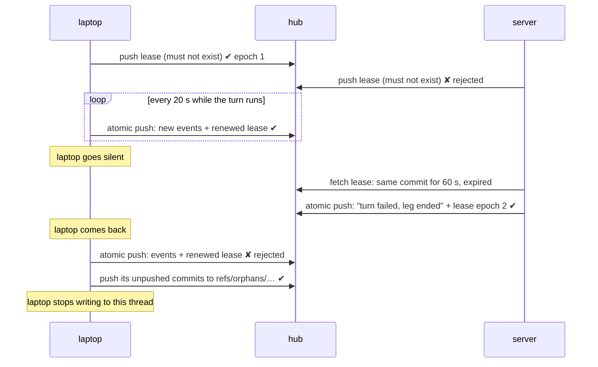

# 03 · Sync and lease

The hub is the git remote of the weevbook: any private git repository every machine can push to. Each thread has
its own git ref, so two busy threads never block each other. To write to a thread a machine must hold its lease, and
a lease is taken, renewed and lost with ordinary git pushes that either fully succeed or fully fail.



## The refs

| Ref | Holds | Written by | How |
|---|---|---|---|
| `refs/threads/<id>` | A chain of commits. The tree is the thread folder itself: `events.jsonl`, `thread.md`, … at the root. | the lease holder | fast-forward only |
| `refs/leases/<id>` | One commit with no parent. The tree is one file, `lease.json`. | the holder, or a machine taking the lease | compare-and-swap: `--force-with-lease` |
| `refs/checkpoints/<id>` | Checkpoint commits of the project's code ([04](04-resume.md)). Unrelated history, same repository. | the lease holder | fast-forward only |
| `refs/orphans/<id>/<machine>-<epoch>` | Commits a machine made after it lost the lease. | that machine | created once; deleted by the holder after it wrote the `note` |
| `refs/engines/<machine>` | One commit with no parent. The tree is `engines.json` ([06](06-dispatch.md)). | that machine only | forced |
| `refs/heads/main` | The browsable tree of [02](02-weevbook.md). | any machine | fast-forward; recomposed when rejected |

A plain `git clone` fetches only `main`: small, readable, and complete for reading. The other refs are fetched by
weevils with explicit refspecs.

**Commits on a thread ref.** One when a turn starts (the message, `accepted`, `assigned`, `leg.start`, `running`),
one with each lease renewal that has new events, one when the turn ends. The subject is
`turn 2 · claude · server` (`turn 2 (running) · …` before the end). Writes outside a turn have their own subject:
`chat · chatgpt · 6 messages`, `meta · server`, `note · server`. `git log` on a thread ref reads like the thread.

## The lease

`lease.json`:

| Field | Meaning |
|---|---|
| `v` | `1` |
| `thread` | The thread id. |
| `holder` | The machine that may write. |
| `engine`, `leg` | The engine and leg at work; `null` when the holder only files content (a connector upload, a `meta`). |
| `epoch` | Starts at 1. Grows by 1 each time the holder changes. Written into `leg.start`. |
| `state` | `working` (a turn is assigned or running) or `idle`. |
| `turn` | The turn at work, when `working`. |
| `taken`, `renewed`, `expires` | UTC times by the holder's clock. `expires` is `renewed` + 60 s. |
| `tip` | The commit of `refs/threads/<id>` pushed together with this lease. |

```json
{"v":1,"thread":"01M7M8E6XR7ZVPYA7TRMHKHR25","holder":"laptop","engine":"claude:a3f9c1@laptop","leg":"L1","epoch":1,
 "state":"working","turn":2,"taken":"2026-11-17T08:02:13Z","renewed":"2026-11-17T08:12:41Z",
 "expires":"2026-11-17T08:13:41Z","tip":"9adfb7a34e4a513eb760d627d9bba045a8271eb5"}
```

### The operations, as git

`$new` is a fresh lease commit (`git hash-object -w`, `git mktree`, `git commit-tree`, no parent); `$old` is the lease
commit the machine last fetched or pushed.

| Operation | When | Push |
|---|---|---|
| **take** | No lease exists. | `git push hub $new:refs/leases/<id> --force-with-lease=refs/leases/<id>:` (empty value: the ref must not exist) |
| **take over idle** | The lease is `idle`, whoever holds it. | `git push hub $new:refs/leases/<id> --force-with-lease=refs/leases/<id>:$old` |
| **renew** | Every 20 s while `working`; at each start and end of a turn. | `git push --atomic hub refs/threads/<id> $new:refs/leases/<id> --force-with-lease=refs/leases/<id>:$old` |
| **go idle** | The turn is done, failed or held. | Same push as renew, with `state: idle`. The thread stays with this machine until someone else needs it. |
| **steal** | The lease is `working`, **and** `expires` + 30 s is past by the local clock, **and** this machine has seen the same lease commit for 60 s by its own clock. | Same push as renew, with the new holder and `epoch` + 1. The thread commit in that push holds `turn failed` and `leg.end` ([01](01-thread.md)). |
| **lose** | Any of the pushes above is rejected and the fetched lease names another holder. | Stop the engine's turn. `git push hub refs/threads/<id>:refs/orphans/<id>/<machine>-<epoch>`. Write nothing more to the thread. |

`--atomic` makes the hub apply both ref updates or neither. `--force-with-lease=<ref>:<value>` makes the hub refuse
unless the ref still has that value. Together: a machine can extend a thread only while the lease is still the one
it knows. A machine that lost the lease cannot push to the thread, even one commit, even if it never noticed.

The holder folds an orphan ref into the journal as one `note` of kind `late` (the events, the checkpoint commit if
there is one), then deletes the ref. The events are kept; they are never mixed into the thread.

- **The note.** `leg`: the first leg of the late events that the thread knows; `text`: `laptop came back with 2
  events of L2 it had not pushed; kept here, not part of the thread`; `data`: `from` (the orphan ref), `events` (the
  late events without `v`, `seq`, `id` and `leg`, which only made sense in the losing copy) and `checkpoint` (the
  commit of the last checkpoint among them). The late events are the orphan's events after the longest run of ids it
  shares with the thread from the start.
- **When.** The next push of the holder to that thread carries the note, and deletes the ref in the same atomic push
  (`:refs/orphans/<id>/<machine>-<epoch>` with `--force-with-lease=` that ref`:`its commit). An orphan whose events
  are all in the thread already is deleted with no note. In practice the dispatcher's machine does it, the next time
  the lease is idle.

### Who writes what

Decided with the simulator (step 4); `lease.ts` implements the rules and `sim/world.ts` the roles.

- **The dispatcher's machine files messages.** A message is acknowledged to the phone once it is on the dispatcher's
  disk, with its idempotency key; a message sent again with a known key is acknowledged and not filed again. While
  the lease is `idle` (or absent: then `meta` first), the dispatcher writes `message` and `turn accepted` itself
  (take, or take over idle). While it is `working`, it hands the message to the holder, which appends it at its next
  renewal. The dispatcher keeps the message until its key is in the thread, and hands it again every 30 s.
- **The machine of the chosen engine starts the turn.** In the one push that takes over the idle lease it writes
  `leg.end` (`moved`, when the open leg is another engine's), `turn assigned`, `leg.start` (when the leg is new) and
  `turn running`. The compare-and-swap on the lease also pins the thread tip that machine read: if anything moved,
  it reads again and tries once more. If the turn has not started 30 s after the decision (the machine never took
  the lease), the dispatcher decides again; no attempt is spent.
- **The engine's machine ends it**: `done`, or a checkpoint when there was an effect, `turn failed` and `leg.end`
  (`quota` or `error`), and goes idle in the same push.
- **The dispatcher's machine steals.** It reads every `working` lease every 10 s. The steal push writes `turn failed`
  (reason `machine-lost`; `effect: none` if the turn was only `assigned`, `some` once `running`, because what the
  engine did after its last push is unknown) and `leg.end` (`machine-lost`, `by` the stealer), and leaves the lease
  `idle`. The turn is then placed like any failed turn.
- **A lease that names this machine** with the epoch it pushed is its own write, even when the answer to the push was
  lost: it adopts it.
- **After a restart** a machine reads its own `working` leases first. Still the holder: it pushes what it committed
  locally, writes `turn failed` (`machine-lost`, effect as for a steal) and `leg.end`, and goes idle; the holder does
  not change, so neither does the epoch. No longer the holder: what it did not push goes to an orphan ref.
- **A leg can outlive an epoch.** The dispatcher taking an idle lease to file a message changes the holder and the
  epoch, but not the leg: the next turn on the same engine continues it. `epoch` in `leg.start` is the epoch the leg
  started under.

### Clocks

Machines' clocks are assumed to agree within 30 s. The protocol stays safe when they do not:

- A steal needs the lease commit to stay unchanged for 60 s on the stealer's own clock. A holder that is alive and
  connected changes it every 20 s. So a wrong clock can delay a steal; it cannot take a thread from a live,
  connected holder.
- If a steal is wrong anyway (the holder was alive but cut off from the hub for more than about a minute and a half), the holder
  loses at its next push. Two engines may have worked for a while; only one of them is in the thread. The other's
  work is in a `note` and in its own checkpoint.
- **How late.** With the stealer reading leases every 10 s, a dead holder's lease goes at the latest
  max(60 + 30 + 30, 10 + 60) + 10 = **130 s** after its last renewal, counted on the stealer's clock (a clock that
  runs 3 % slow makes it 3 % longer). A holder whose clock is ahead by more than 30 s delays the steal by the
  difference; a holder whose clock is behind cannot make it earlier than 60 s unchanged.
- **What the simulator saw.** Over 20,000 runs, one in six with a clock minutes wrong or drifting by 1 to 3 %, no
  holder that could renew ever lost its lease: clocks changed how long a dead holder kept its threads, never who
  could write.

## Sync

- **Before a turn**: fetch the thread ref and the lease ref. The push that starts the turn fails if either moved.
- **During a turn**: every 20 s, one atomic push per machine carries all its working leases and their new events.
- **After a turn**: push the thread, the lease (`idle`) and the checkpoint, then compose `main`.
- **Offline**: the engine keeps working and commits locally. Back online, the next renewal either passes (nobody
  took the lease: everything is pushed) or is rejected (see **lose**).
- **One machine, no hub**: the same refs, in the local repository. Nothing is pushed. A hub added later receives
  everything at the first push.

A hub must accept atomic pushes and refs outside `refs/heads`. weevils checks both at setup with a throwaway ref and
refuses a hub that fails.

### Composing `main`

`main` is a view, never a source. Its tree is a pure function of the thread refs:

```
README.md
index.json                                   { thread, path, title, project, updated, state, commit } per thread
projects/<project>/<YYYY-MM>/<id>-<slug>/    = the tree of refs/threads/<id> at the commit named in index.json
```

1. Fetch `refs/threads/*` and `main`.
2. For each thread take the newer of: the fetched tip, the commit in the previous `index.json`.
3. Build the tree with `git mktree` (thread trees are reused as they are: no file is copied), commit with the
   previous `main` as parent. The message lists the thread commits added since.
4. Push fast-forward. If rejected, another machine composed first: go to 1.

Because every composer starts from the previous `main`, a thread's folder never goes back to an older commit.

## Invariants

To be tested with two real repositories at step 2, and by the simulator at step 4.

- **SYNC-1** For one thread and one epoch, at most one machine can push to `refs/threads/<id>`.
- **SYNC-2** `refs/threads/<id>` only moves forward: each new tip has the previous one as ancestor, and its journal
  extends the previous journal (BOOK-2).
- **SYNC-3** Every accepted push to `refs/threads/<id>` comes with a lease whose `holder` is the pusher and whose
  `tip` is the pushed commit.
- **SYNC-4** `epoch` never decreases, and changes exactly when `holder` changes.
- **SYNC-5** A `working` lease is replaced by another holder only after 60 s without change and past `expires` +
  30 s.
- **SYNC-6** A machine whose push was rejected for the lease writes no further event to that thread until it holds
  the lease again.
- **SYNC-7** Every commit a machine made and could not push is, in the end, either in the thread or named by a
  `note`. None is dropped.
- **SYNC-8** The tree of `main` equals the composition of `index.json`; each commit in `index.json` is the tip of
  its thread ref or an ancestor of it.
- **SYNC-9** Deleting `main` and composing again gives the same tree.
- **SYNC-10** A push about one thread never depends on another thread's refs. In the batch of renewals each lease
  is checked on its own; when one is rejected, the batch is pushed again without it.
- **SYNC-11** Simulator: with the dispatcher's machine up and clocks within 30 s, a `working` lease whose holder
  stopped renewing is stolen within 130 s of its last renewal.
- **SYNC-12** Simulator: a machine stops its engine at its first push that reaches the hub after it lost the lease.
  Two engines never write to the hub for one thread at once.

## Failure cases

| What happens | Result |
|---|---|
| Two machines take the same free lease at once | One push wins. The other is rejected (`stale info`) and does not start. |
| The holder's machine dies mid-turn | After about one and a half to two minutes another machine steals, writes `turn failed` (`machine-lost`) and continues ([04](04-resume.md)). |
| The holder is alive but offline for longer than that | Same steal. On return the holder loses: its commits go to an orphan ref and come back as a `note`. Its code is in its own checkpoint, named in the note. |
| The old machine comes back while the new one answers | Its first push is rejected. It stops. Nothing it wrote reaches the thread. |
| The hub is unreachable for everyone | Each machine keeps working on the threads it holds. No lease changes hands. |
| A push dies half-way | Atomic: the hub has all of it or none. The machine pushes again. |
| `main` is composed by two machines at once | One push is rejected; that machine composes again. |
| A hub without atomic push | Refused at setup. |

## Open decisions

**D1 · A hub for people without a server.** A person with a laptop and a desktop has no machine that is always on.
The hub could be a private repository on their own GitHub account, created by weevils at setup (`gh` is already
optional in the install). The lease protocol above works on GitHub as it is.
*Recommendation: yes, but not before D2 is built.* Without D2, command lines, file contents and the project's code
(the checkpoints) would sit on GitHub in clear, protected only by pattern-based redaction.

**D2 · Encryption for a hub you do not own.** Encrypt what leaves for such a hub, with a key shared between your
machines when they are paired. Constraints found while writing this page:

- The hub must still see real refs and real commits, or the lease cannot work. So whole-repository encryption (the
  hub sees one opaque blob) is out. Encryption is per file content.
- File names must tell nothing. Thread refs already have fixed names at their root, with no title in them. `main`
  has titles in folder names: it is not pushed to an encrypted hub.
- Checkpoints are the project's code: they would travel as encrypted incremental bundles, not as plain commits.
- Costs: nothing readable on GitHub; no delta compression, so the repository grows faster; a lost key makes the
  hub's copy unreadable (the machines' own copies stay readable).

*Recommendation: yes for any hub outside your own machines; none needed for a hub on your own server over SSH.
Ship steps 1 to 3 with own-server and no-hub only.*

## What exists today

- [`server/weevbook/lease.ts`](../../server/weevbook/lease.ts): `lease.json`, the rules above as pure functions
  (`plan`, `stealable`, `standing`, `lateNote`), and `LeaseClient`, which runs them as the git pushes of this page
  with an injected clock and git runner. `lease.test.ts` runs two machines against a real bare repository: two
  takers at once, steal timing, the old holder rejected and its orphan, clocks 30 s apart and far beyond. Nothing in
  the app uses it yet.
- `server/weevbook/sim`: the same rules over an in-memory hub with the same guarantees (atomic push,
  compare-and-swap, fast-forward only), checked after every simulated run.
- No hub in the app. A machine's threads never leave it, except by hand with `server/bring.ts`.
- `server/remotes.ts`: a main machine reads the other machines' servers every 2 s through a reverse SSH tunnel
  (`WEEVILS_REMOTES`). It is a live view, not storage: when a machine is off, its sessions are gone from the app.
  The hub replaces it for content; it stays useful to know quickly that a machine is reachable.
- `server/config.ts` gives each machine a stable id (`WEEVILS_MACHINE`, or the host name kept in `machine-id`). That
  id is `holder` and the machine part of an engine id.
- `server/outbox.ts` marks a delivery that was interrupted as `uncertain` and never retries it, because it cannot
  know whether the other side received it. With a lease the question has an answer in the hub: the other machine
  took the lease, or it did not.
- The git commands of this page were run against a bare repository with stock git while writing it: take, a losing
  second take, atomic renew, steal, the rejected push of the old holder, the orphan push, `mktree` composition.

## Not in v1

- Encryption (D2), and therefore GitHub as a hub (D1).
- Several people sharing one weevbook.
- Garbage collection of old lease commits and of checkpoints of closed threads (git's own `gc` handles unreachable
  lease commits; checkpoint pruning is specified with step 2).
- A hub that is not git.
