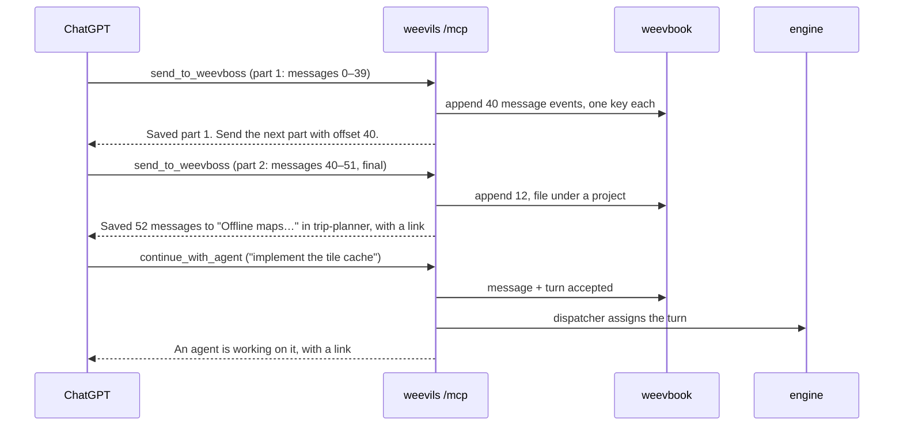

# 05 · Connector

The connector is one address you add to a chat app (ChatGPT, Claude.ai): `https://<your weevils>/mcp`. It is an
[MCP](https://modelcontextprotocol.io) server with five tools. With it, a chat becomes a thread of your weevbook, an
engine can continue it, and a thread born elsewhere can be read back into the chat.



## A worked example

The sample thread [`offline-maps-for-the-itinerary`](../../examples/weevbook/projects/trip-planner/2026-11/01M7TK6GX01G5BY7YG590JEA4Q-offline-maps-for-the-itinerary/thread.md)
was made by these two calls. First the chat itself:

```json
{ "name": "send_to_weevboss",
  "arguments": {
    "conversation": "offline-maps-for-the-itinerary", "app": "chatgpt",
    "title": "Offline maps for the itinerary", "offset": 0, "final": true,
    "messages": [
      { "role": "user", "text": "I'm building trip-planner, a small web app for our hiking trips. …" },
      { "role": "assistant", "text": "Three realistic options: …" }
    ] } }
```

(six messages in the real call). Each becomes one event, with a key built from the call:

```json
{"v":1,"seq":2,"id":"01M7TK6GX0…","at":"2026-11-19T19:05:40Z","leg":null,"type":"message","role":"user","text":"I'm building trip-planner, …","source":"connector","app":"chatgpt","key":"conn:chatgpt:offline-maps-for-the-itinerary:0:791a672974e4a01e"}
```

The answer the model gets is one sentence and a link:

```
Saved 6 messages to "Offline maps for the itinerary" in trip-planner. https://weevils.example.com/t/01M7TK6GX01G5BY7YG590JEA4Q
```

Then the request for an engine:

```json
{ "name": "continue_with_agent",
  "arguments": { "conversation": "offline-maps-for-the-itinerary", "app": "chatgpt", "request": "tile-cache-with-cap",
                 "instruction": "Implement the tile cache we discussed, with the 40 MB cap and the progress bar." } }
```

## The five tools

Five and no more: a model chooses badly among thirty. Below, each tool as the chat app receives it: its description
and its input schema. `$thread` stands for `{ "type": "string", "pattern": "^[0-9A-HJKMNP-TV-Z]{26}$" }`,
`$conversation` for `{ "type": "string", "pattern": "^[a-z0-9-]{8,80}$", "description": "A name you choose once for
this chat and reuse in every call about it." }` and `$app` for `{ "enum": ["chatgpt", "claude-ai"] }`.

**`send_to_weevboss`**: "Save this chat in the user's weevbook. Send every message in order. More than 40 messages:
send several parts, each with the offset of its first message, and `final: true` on the last."

```json
{ "type": "object", "additionalProperties": false,
  "required": ["app", "offset", "messages", "final"],
  "anyOf": [{ "required": ["conversation"] }, { "required": ["thread"] }],
  "properties": {
    "conversation": $conversation, "thread": $thread, "app": $app,
    "title": { "type": "string", "maxLength": 120 },
    "project": { "type": "string", "maxLength": 60, "description": "Only if the user named a project." },
    "offset": { "type": "integer", "minimum": 0, "description": "Position in the chat of the first message of this part." },
    "messages": { "type": "array", "minItems": 1, "maxItems": 40, "items": {
      "type": "object", "additionalProperties": false, "required": ["role", "text"],
      "properties": { "role": { "enum": ["user", "assistant"] }, "text": { "type": "string", "maxLength": 20000 } } } },
    "final": { "type": "boolean" } } }
```

**`continue_with_agent`**: "Ask a coding agent on the user's machines to work on a thread. Save the chat first with
send_to_weevboss if it is not saved."

```json
{ "type": "object", "additionalProperties": false,
  "required": ["instruction", "request"],
  "anyOf": [{ "required": ["thread"] }, { "required": ["conversation", "app"] }],
  "properties": {
    "thread": $thread, "conversation": $conversation, "app": $app,
    "instruction": { "type": "string", "minLength": 1, "maxLength": 8000, "description": "What the agent must do, in full sentences." },
    "request": { "type": "string", "pattern": "^[a-z0-9-]{4,60}$", "description": "A short name for this request. Reuse it only to retry the same call." },
    "project": { "type": "string", "maxLength": 60 } } }
```

**`search_weevbook`**: "Find threads of the user's weevbook by words of their title, project or subject."

```json
{ "type": "object", "additionalProperties": false, "required": ["query"],
  "properties": {
    "query": { "type": "string", "minLength": 1, "maxLength": 200 },
    "project": { "type": "string", "maxLength": 60 },
    "limit": { "type": "integer", "minimum": 1, "maximum": 10, "default": 5 } } }
```

**`read_thread`**: "Read a thread, to continue it here. `summary` gives a summary of it; `recent` gives its last messages."

```json
{ "type": "object", "additionalProperties": false, "required": ["thread", "mode"],
  "properties": {
    "thread": $thread,
    "mode": { "enum": ["summary", "recent"] },
    "count": { "type": "integer", "minimum": 1, "maximum": 20, "default": 6, "description": "For recent." } } }
```

**`thread_status`**: "Say where a thread stands: an agent is working, it waits for the user, or it is paused."

```json
{ "type": "object", "additionalProperties": false,
  "anyOf": [{ "required": ["thread"] }, { "required": ["conversation", "app"] }],
  "properties": { "thread": $thread, "conversation": $conversation, "app": $app } }
```

### Results

Every result is `{ "content": [{ "type": "text", "text": … }] }`: text written for a model to repeat, never a JSON
dump. A failure adds `"isError": true` and says in one sentence what to do.

| Tool | Text | Limit |
|---|---|---|
| `send_to_weevboss`, part | `Saved part 1 (messages 0 to 39). Send the next part with offset 40.` | 200 characters |
| `send_to_weevboss`, final | `Saved 52 messages to "<title>" in <project>. <link>` | 300 |
| `send_to_weevboss`, replay | `Already saved: nothing new in messages 0 to 39. <link>` | 300 |
| `continue_with_agent` | `An agent is working on "<title>" in <project>. Ask for thread_status to follow it. <link>` | 300 |
| `continue_with_agent`, held | `Saved. No machine can work on it now: <reason>. It starts as soon as one can. <link>` | 300 |
| `search_weevbook` | One line per thread: `<thread id> · <title> · <project> · <updated> · <state>` | 10 lines |
| `read_thread` | The handoff, or the messages. | 12,000 |
| `thread_status` | `"<title>" (<project>): <working \| waiting for you \| paused: what to do>. Last reply: "<first 300 characters>"` | 600 |

`<link>` is `https://<your weevils>/t/<thread id>`, which opens the thread in the app.

## Parts and idempotency

- **One key per message**: `conn:<app>:<conversation>:<ordinal>:<hash>`, where `<ordinal>` is `offset` plus the
  position in the part, and `<hash>` is the first 16 hex characters of the SHA-256 of `role`, a line feed and
  `text`. A request key is `conn:<app>:<conversation>:req:<request>`.
- **A replayed part writes nothing.** Every key is already in the journal (THREAD-9). The result says so.
- **The key is the mapping.** The thread of a `conversation` is the thread whose journal holds keys with that
  prefix. No separate table can drift.
- **Parts come in order.** `offset` must be the number of messages already saved for that conversation, or lower (a
  replay). A gap is an error: `Send messages starting at offset 40 first.`
- **A message that changed.** The same ordinal with another hash (the user edited the chat) is not written again.
  The saved version stays, and the result adds: `2 earlier messages differ from what was saved; the saved version was
  kept.`
- **One commit per part** on the thread ref (`chat · chatgpt · 40 messages`). `final: true` adds the title and the
  project (`meta`) and composes `main`.
- **Who writes.** The connector never writes to a journal by itself. It hands the events to the lease holder of the
  thread, or takes the lease when nobody holds it ([03](03-sync-and-lease.md)).

## Sign-in

The connector follows the MCP authorization rules: OAuth 2.1, authorization code with PKCE, dynamic client
registration, and the protected-resource metadata that tells the chat app where to sign in.

| Step | What |
|---|---|
| Discovery | `GET /.well-known/oauth-protected-resource` and `/.well-known/oauth-authorization-server`, served by weevils itself. |
| Registration | `POST /mcp/register`. The chat app registers itself; weevils keeps its name and redirect address. |
| Consent | `GET /mcp/authorize` shows one page: the chat app's name, what it will be able to do, and a field for the weevils access code (skipped when this browser is already signed in). Wrong codes are slowed and capped like the app's own sign-in. |
| Tokens | `POST /mcp/token`. Access token: 256 random bits, valid 1 hour. Refresh token: valid 30 days, replaced at each use. Only their SHA-256 is stored, in a file of the data folder readable by the user only. |
| Scope | One scope, `weevbook`. A connector token is accepted on `/mcp` and nowhere else: not on `/api`, not for files, not for settings. |
| Revoking | From the app, per chat app. Changing the access code revokes every connector token. |

## Invariants

To be tested at step 5 against a fake MCP client.

- **CONN-1** The connector offers exactly five tools, with the names above.
- **CONN-2** Sending the same part twice leaves the journal byte for byte the same.
- **CONN-3** Sending a chat in N parts gives the same `message` events as sending it in one, apart from `id` and
  `at`.
- **CONN-4** The same `request` name on `continue_with_agent` starts at most one turn.
- **CONN-5** No tool result is longer than its limit, and none is a JSON document.
- **CONN-6** A connector token reaches no route other than `/mcp`; a call can read and append to the weevbook and
  start a turn, and nothing else. It cannot read a file, run a command or change a setting.
- **CONN-7** A call without a valid token gets `401` with the address of the protected-resource metadata, and
  writes nothing.
- **CONN-8** Text from the connector is redacted like any other ([02](02-weevbook.md#redaction)).

## Failure cases

| What happens | Result |
|---|---|
| The chat app's call times out and it retries | Same keys: nothing is written twice. Same answer. |
| A part is skipped | Error with the offset to send first. Nothing is written. |
| The model invents a different `conversation` name for the same chat | A second thread is made. `search_weevbook` finds both. The user can say which to keep; merging is not in v1. |
| No engine can take `continue_with_agent` | The message is saved, the turn is `held`, and the result says why in the dispatcher's own sentence. |
| The thread is being written by another machine | The events are handed to the holder. If it cannot be reached, the call fails with "try again in a minute" and nothing is written. |
| The token expired | `401`; the chat app refreshes it by itself. |
| The weevils address changed (a temporary tunnel address) | The connector must be added again in the chat app. A stable address is needed for a connector that lasts. |

## What exists today

- No MCP endpoint and no OAuth. The app signs in with the access code and a device cookie (`server/http.ts`,
  `server/login-limit.ts`: an 800 ms pause after a wrong code, and a ceiling per address).
- `server/conversations.ts` imports whole ChatGPT and Claude.ai exports from a file. The connector is the live
  version of that door: one chat at a time, from inside the chat. Exports become the `import` source.
- `server/boss-door.ts` refuses anything that speaks to weevboss as the user unless it comes from a browser signed
  in with the access code. The connector is a second, explicit way to speak as the user: each chat app is approved
  once on the consent page, and what it sends is marked `source: connector` for good.
- `server/outbox.ts` accepts a message once per `messageId`. `continue_with_agent` enters through it with a
  `messageId` derived from its request key.
- The route `/t/<thread id>` does not exist yet; it comes with the weevbook page.

## Not in v1

- Files and images from the chat: the model only has the text on screen.
- Earlier versions of edited messages, and other branches of the chat.
- Merging two threads.
- Chat apps other than ChatGPT and Claude.ai. Any MCP client can call the tools; `app` only knows these two names.
- Sending without the model: a browser extension or a share link.
