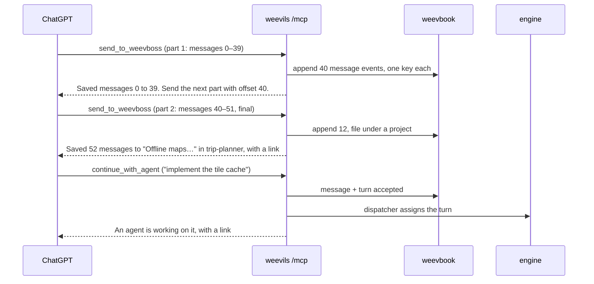

# 05 · Connector

The connector is one address you add to a chat app (ChatGPT, Claude.ai): `https://<your weevils>/mcp`. It is an
[MCP](https://modelcontextprotocol.io) server with five tools. With it, a chat becomes a thread of your weevbook, an
engine can continue it, and a thread born elsewhere can be read back into the chat.



## A worked example

The sample thread [`offline-maps-for-the-itinerary`](../../examples/weevbook/projects/trip-planner/2026-11/01M7TK6GX01G5BY7YG590JEA4Q-offline-maps-for-the-itinerary/thread.md)
was made by these two calls. First the chat itself:

```json
{ "name": "send_to_weevboss",
  "arguments": {
    "conversation": "offline-maps-for-the-itinerary", "app": "chatgpt",
    "title": "Offline maps for the itinerary", "offset": 0, "final": true,
    "messages": [
      { "role": "user", "text": "I'm building trip-planner, a small web app for our hiking trips. …" },
      { "role": "assistant", "text": "Three realistic options: …" }
    ] } }
```

(six messages in the real call). Each becomes one event, with a key built from the call:

```json
{"v":1,"seq":2,"id":"01M7TK6GX0…","at":"2026-11-19T19:05:40Z","leg":null,"type":"message","role":"user","text":"I'm building trip-planner, …","source":"connector","app":"chatgpt","key":"conn:chatgpt:offline-maps-for-the-itinerary:0:791a672974e4a01e"}
```

The answer the model gets is one sentence and a link:

```
Saved 6 messages to "Offline maps for the itinerary" in trip-planner. https://weevils.example.com/t/01M7TK6GX01G5BY7YG590JEA4Q
```

Then the request for an engine:

```json
{ "name": "continue_with_agent",
  "arguments": { "conversation": "offline-maps-for-the-itinerary", "app": "chatgpt", "request": "tile-cache-with-cap",
                 "instruction": "Implement the tile cache we discussed, with the 40 MB cap and the progress bar." } }
```

## The five tools

Five and no more: a model chooses badly among thirty. Below, each tool as the chat app receives it: its description
and its input schema. `$thread` stands for `{ "type": "string", "pattern": "^[0-9A-HJKMNP-TV-Z]{26}$" }`,
`$conversation` for `{ "type": "string", "pattern": "^[a-z0-9-]{8,80}$", "description": "A name you choose once for
this chat and reuse in every call about it." }` and `$app` for `{ "enum": ["chatgpt", "claude-ai"] }`.

**`send_to_weevboss`**: "Save this chat in the user's weevbook. Send every message in order. More than 40 messages:
send several parts, each with the offset of its first message, and `final: true` on the last."

```json
{ "type": "object", "additionalProperties": false,
  "required": ["app", "offset", "messages", "final"],
  "anyOf": [{ "required": ["conversation"] }, { "required": ["thread"] }],
  "properties": {
    "conversation": $conversation, "thread": $thread, "app": $app,
    "title": { "type": "string", "maxLength": 120 },
    "project": { "type": "string", "maxLength": 60, "description": "Only if the user named a project." },
    "offset": { "type": "integer", "minimum": 0, "description": "Position in the chat of the first message of this part." },
    "messages": { "type": "array", "minItems": 1, "maxItems": 40, "items": {
      "type": "object", "additionalProperties": false, "required": ["role", "text"],
      "properties": { "role": { "enum": ["user", "assistant"] }, "text": { "type": "string", "maxLength": 20000 } } } },
    "final": { "type": "boolean" } } }
```

**`continue_with_agent`**: "Ask a coding agent on the user's machines to work on a thread. Save the chat first with
send_to_weevboss if it is not saved."

```json
{ "type": "object", "additionalProperties": false,
  "required": ["instruction", "request"],
  "anyOf": [{ "required": ["thread"] }, { "required": ["conversation", "app"] }],
  "properties": {
    "thread": $thread, "conversation": $conversation, "app": $app,
    "instruction": { "type": "string", "minLength": 1, "maxLength": 8000, "description": "What the agent must do, in full sentences." },
    "request": { "type": "string", "pattern": "^[a-z0-9-]{4,60}$", "description": "A short name for this request. Reuse it only to retry the same call." },
    "project": { "type": "string", "maxLength": 60 } } }
```

**`search_weevbook`**: "Find threads of the user's weevbook by words of their title, project or subject."

```json
{ "type": "object", "additionalProperties": false, "required": ["query"],
  "properties": {
    "query": { "type": "string", "minLength": 1, "maxLength": 200 },
    "project": { "type": "string", "maxLength": 60 },
    "limit": { "type": "integer", "minimum": 1, "maximum": 10, "default": 5 } } }
```

**`read_thread`**: "Read a thread, to continue it here. `summary` gives a summary of it; `recent` gives its last messages."

```json
{ "type": "object", "additionalProperties": false, "required": ["thread", "mode"],
  "properties": {
    "thread": $thread,
    "mode": { "enum": ["summary", "recent"] },
    "count": { "type": "integer", "minimum": 1, "maximum": 20, "default": 6, "description": "For recent." } } }
```

**`thread_status`**: "Say where a thread stands: an agent is working, it waits for the user, or it is paused."

```json
{ "type": "object", "additionalProperties": false,
  "anyOf": [{ "required": ["thread"] }, { "required": ["conversation", "app"] }],
  "properties": { "thread": $thread, "conversation": $conversation, "app": $app } }
```

### Results

Every result is `{ "content": [{ "type": "text", "text": … }] }`: text written for a model to repeat, never a JSON
dump. A failure adds `"isError": true` and says in one sentence what to do.

| Tool | Text | Limit |
|---|---|---|
| `send_to_weevboss`, part | `Saved messages 0 to 39. Send the next part with offset 40.` | 200 characters |
| `send_to_weevboss`, final | `Saved 52 messages to "<title>" in <project>. <link>` | 300 |
| `send_to_weevboss`, replay | `Already saved: nothing new in messages 0 to 39. <link>` | 300 |
| `continue_with_agent` | `An agent is working on "<title>" in <project>. Ask for thread_status to follow it. <link>` | 300 |
| `continue_with_agent`, held | `Saved. No machine can work on it now: <reason>. It starts as soon as one can. <link>` | 300 |
| `search_weevbook` | One line per thread: `<thread id> · <title> · <project> · <updated> · <state>` | 10 lines |
| `read_thread` | The handoff, or the messages. | 12,000 |
| `thread_status` | `"<title>" (<project>): <working \| waiting for you \| paused: what to do>. Last reply: "<first 300 characters>"` | 600 |

`<link>` is `https://<your weevils>/t/<thread id>`, which opens the thread in the app.

## Parts and idempotency

- **One key per message**: `conn:<app>:<conversation>:<ordinal>:<hash>`, where `<ordinal>` is `offset` plus the
  position in the part, and `<hash>` is the first 16 hex characters of the SHA-256 of `role`, a line feed and
  `text`. A request key is `conn:<app>:<conversation>:req:<request>`.
- **A replayed part writes nothing.** Every key is already in the journal (THREAD-9). The result says so.
- **The key is the mapping.** The thread of a `conversation` is the thread whose journal holds keys with that
  prefix. No separate table can drift.
- **Parts come in order.** `offset` must be the number of messages already saved for that conversation, or lower (a
  replay). A gap is an error: `Send messages starting at offset 40 first.`
- **A message that changed.** The same ordinal with another hash (the user edited the chat) is not written again.
  The saved version stays, and the result adds: `2 earlier messages differ from what was saved; the saved version was
  kept.`
- **One commit per part** on the thread ref (`chat · chatgpt · 40 messages`). `final: true` adds the title and the
  project (`meta`) and composes `main`.
- **Who writes.** The connector never writes to a journal by itself. It hands the events to the lease holder of the
  thread, or takes the lease when nobody holds it ([03](03-sync-and-lease.md)). At step 5, before leases run, it
  writes through the local store under the weevbook's lock ([Step 5](#step-5-the-connector-in-weevilsd)).

## Sign-in

The connector follows the MCP authorization rules: OAuth 2.1, authorization code with PKCE, dynamic client
registration, and the protected-resource metadata that tells the chat app where to sign in.

| Step | What |
|---|---|
| Discovery | `GET /.well-known/oauth-protected-resource` and `/.well-known/oauth-authorization-server`, served by weevils itself. |
| Registration | `POST /mcp/register`. The chat app registers itself; weevils keeps its name and redirect address. |
| Consent | `GET /mcp/authorize` shows one page: the chat app's name, what it will be able to do, and a field for the weevils access code (skipped when this browser is already signed in). Wrong codes are slowed and capped like the app's own sign-in. |
| Tokens | `POST /mcp/token`. Access token: 256 random bits, valid 1 hour. Refresh token: valid 30 days, replaced at each use. Only their SHA-256 is stored, in a file of the data folder readable by the user only. |
| Scope | One scope, `weevbook`. A connector token is accepted on `/mcp` and nowhere else: not on `/api`, not for files, not for settings. |
| Revoking | From the app, per chat app. Changing the access code revokes every connector token. |

What each step does exactly, and what ChatGPT and Claude.ai require of it, is in [Step 5](#step-5-the-connector-in-weevilsd).

## Invariants

To be tested at step 5 against a fake MCP client.

- **CONN-1** The connector offers exactly five tools, with the names above.
- **CONN-2** Sending the same part twice leaves the journal byte for byte the same.
- **CONN-3** Sending a chat in N parts gives the same `message` events as sending it in one, apart from `id` and
  `at`.
- **CONN-4** The same `request` name on `continue_with_agent` starts at most one turn.
- **CONN-5** No tool result is longer than its limit, and none is a JSON document.
- **CONN-6** A connector token reaches no route other than `/mcp`; a call can read and append to the weevbook and
  start a turn, and nothing else. It cannot read a file, run a command or change a setting.
- **CONN-7** A call without a valid token gets `401` with the address of the protected-resource metadata, and
  writes nothing.
- **CONN-8** Text from the connector is redacted like any other ([02](02-weevbook.md#redaction)).

## Failure cases

| What happens | Result |
|---|---|
| The chat app's call times out and it retries | Same keys: nothing is written twice. Same answer. |
| A part is skipped | Error with the offset to send first. Nothing is written. |
| The model invents a different `conversation` name for the same chat | A second thread is made. `search_weevbook` finds both. The user can say which to keep; merging is not in v1. |
| No engine can take `continue_with_agent` | The message is saved, the turn is `held`, and the result says why in the dispatcher's own sentence. |
| The weevbook is locked longer than 10 s (a backfill) | `The weevbook is busy. Try again in a minute; nothing was written.` |
| A `conversation` or `request` name with a word redaction hides (`token`, `password`, `secret`, `api-key`, `cookie`…) | Refused before anything is written: redaction would change the key, and the call could never be recognised again. |
| An engine's session writes the thread (a leg is open) | Refused: chat messages go into threads no engine is writing until leases run. |
| The thread is being written by another machine | The events are handed to the holder. If it cannot be reached, the call fails with "try again in a minute" and nothing is written. |
| The token expired | `401`; the chat app refreshes it by itself. |
| The weevils address changed (a temporary tunnel address) | The connector must be added again in the chat app. A stable address is needed for a connector that lasts. |

## Step 5: the connector in weevilsd

What step 5 built, and what it decided where the pages above leave room.

### Where it runs

- **In weevilsd, on the app's port, only with `WEEVILS_CONNECTOR=1`** (`server/connector`). Off, `/mcp` is the app's
  like any other path. The person adds `https://<their weevils>/mcp` in the chat app: the address must be public and
  HTTPS, the one the phone opens.
- **Addresses.** `GET /.well-known/oauth-protected-resource` (and `…/oauth-protected-resource/mcp`),
  `GET /.well-known/oauth-authorization-server`, `POST /mcp`, `POST /mcp/register`, `GET` and `POST /mcp/authorize`,
  `POST /mcp/token`, `POST /mcp/revoke` (RFC 7009). They are answered before the app's own routes.
- **Transport.** MCP streamable HTTP without a session and without a stream: `POST /mcp` answers JSON-RPC with JSON
  (a batch with a list); a notification gets `202`; `GET /mcp` gets `405`. Protocol versions `2025-11-25`,
  `2025-06-18`, `2025-03-26` (the client's if it is one of them, else the newest). Methods: `initialize` (with
  `instructions` telling the model when to call `send_to_weevboss`), `ping`, `tools/list`, `tools/call`, and empty
  `resources/list`, `resources/templates/list`, `prompts/list`. The tools carry annotations: the three read tools
  `readOnlyHint`, all `idempotentHint`, none `destructiveHint` or `openWorldHint`.
- **Its own address.** Links, the issuer and `resource` use the address the chat app reached: `X-Forwarded-Host` (or
  `Host`) with `https` when `X-Forwarded-Proto` says so. `WEEVILS_PUBLIC_URL` wins when it names the same host, or
  when the request came to a loopback name (a tunnel that does not rewrite `Host`). A `Host` that is not a host name is
  ignored.

### Sign-in, as ChatGPT and Claude.ai need it

Both chat apps read the protected-resource metadata from the `401` of `/mcp`
(`WWW-Authenticate: Bearer resource_metadata="<base>/.well-known/oauth-protected-resource", scope="weevbook"`, with
`error="invalid_token"` when a token was sent), then the authorization server metadata, then register (dynamic
client registration), then send the person's browser to the consent page with PKCE `S256`.

| | Decided |
|---|---|
| Metadata | `resource` is `<base>/mcp` exactly (Claude compares it); `authorization_servers` is `[<base>]`; the issuer is `<base>`. `code_challenge_methods_supported: ["S256"]`, `token_endpoint_auth_methods_supported: ["none", "client_secret_post", "client_secret_basic"]`, `scopes_supported: ["weevbook"]`, `authorization_response_iss_parameter_supported: true`: every answer to the redirect address, errors too, carries `iss`. No client-ID metadata documents: both apps register. |
| Who may register | Only the two chat apps: every redirect address of a client is `https://claude.ai/api/mcp/auth_callback` (Claude on the web, desktop and phone), or `https://chatgpt.com/connector_platform_oauth_redirect` or `https://chatgpt.com/connector/oauth/<id>` (ChatGPT). Anything else is `invalid_redirect_uri`. The address tells the app; a token belongs to that app, and the `app` argument of a call is ignored for it. A loopback redirect (Claude Code, other MCP clients) cannot sign in at step 5. |
| Client secret | Always issued (ChatGPT expects one even when it registers as a public client), checked when it is presented, never required: what protects the code is PKCE and the redirect address. At most 200 clients; the oldest that never got a grant make room. |
| Consent page | `GET /mcp/authorize` checks the request first: an unknown client or redirect address gets a page and nothing goes back; a request without `S256`, or with a `resource` that is not this `/mcp`, goes back with an error. A good request waits 10 minutes for the person's answer (at most 100 at a time). The page, in the installation's language and the app's look (one band of colour, bold type, sharp corners): the app's name, what it will be able to do and not do, the host the browser goes back to, the access-code field (none for a browser signed in to weevils), Allow and Cancel. It cannot be framed (`X-Frame-Options: DENY`, `frame-ancestors 'none'`) and its form posts only to itself; an answer from another site is refused with the app's own rule (`appWriteAllowed`). Wrong codes go through the app's limiter (`server/login-limit.ts`: an 800 ms pause, 10 per address and 50 in all per 15 minutes, the right code always gets in). The page signs no browser in. Cancel sends `access_denied`. |
| Code | 256 random bits, one use, 5 minutes, bound to the client, the redirect address, the PKCE challenge and the `resource`. A wrong `code_verifier` spends it. |
| Tokens | Access `wvt_…` 1 hour, refresh `wvr_…` 30 days, both 256 random bits; the refresh token is replaced at each use and the old one is `invalid_grant`. A grant is one approval of one chat app: its access tokens (the last four), its refresh token, when it was made and last used. |
| Storage | `DATA_DIR/connector.json`, mode 0600, written whole and renamed: clients (with the SHA-256 of their secret) and grants (with the SHA-256 of their tokens), and a fingerprint of the access code (HMAC). When the fingerprint differs at start, every grant is dropped: changing the access code revokes every connector token. |
| Listing and revoking | `weevils connector` lists the grants (id, app, made, last used; never a token); `weevils connector revoke <grant id>\|chatgpt\|claude-ai\|all` (`GET` and `DELETE /api/connector[/…]`, for this machine or a signed-in browser). A chat app may revoke its own token (`POST /mcp/revoke`). A screen in the app comes with the settings. |
| Rate limits | Without a valid token: 60 calls a minute per address, then `429`. With one: 120 a minute per grant. Registration: 10 an hour per address. Token and revocation: 60 a minute per address. Consent page: 60 a minute per address. A body over 4 MiB is refused. |
| Scope | A connector token is read on `/mcp` only. `/api` signs in with this machine's local token or the device cookie (`server/http.ts`); it reads `Authorization` only on the Siri Shortcut's two voice routes, against the Shortcut's own token. A connector token opens nothing else (CONN-6). |

### The tools in weevilsd

- **One writer.** Calls run one at a time and each takes the weevbook's lock, as the shadow writer and the
  `weevils weevbook` command do; the lock is waited for 10 s. Each call that writes is one commit on the thread's ref.
  `main` is composed at `final: true`, after `continue_with_agent`, and 60 s after a part without `final`.
- **No engine's thread.** A thread with an open leg (an engine's session, every shadow thread) takes no chat message
  and no request: `leg: null` events there would cross the leg (THREAD-7, THREAD-8). Leases decide this once they run.
- **The key without a conversation.** When a call names only `thread`, the conversation part of its keys is the
  thread id in lower case (it matches `$conversation`): parts sent that way extend that thread like any other.
- **Names redaction would hide** (`my-api-token-chat`) are refused before anything is written.
- **The title.** The `title` given, else the first user message cut near 60 characters. A later `final` with another
  `title` changes it with a `meta` event.
- **The project, at `final`.** The one the user named (slugified), else the repository under the project roots, or the
  project already in the weevbook, whose name appears in the chat's text (the longest such name: `ruleMatch` of
  `server/classify.ts`), else none (the thread is unsorted). A thread already filed keeps its project unless the user
  names another.
- **`continue_with_agent`** writes the request (`role: user`, key `…:req:<request>`), a `meta` if it names a new
  project, and `turn` `accepted`, then asks the dispatcher. The dispatcher of 06 does not run in weevilsd yet (step
  4): until it does, the turn is `held` with rule `hold` and reason `no-machine`, and the result is
  `Saved. No machine can work on it now: none of the user's machines takes work from the weevbook now. It starts as
  soon as one can.` A held turn is assigned when the dispatcher runs: the request starts then. With
  `WEEVILS_THREADS=1` the dispatcher runs: the request goes to its inbox instead (the same key twice is one request),
  a thread with an open leg takes it too (the lease decides), and a request held an hour without starting ends as
  `expired` ("ask again"; [06](06-dispatch.md#step-4-the-dispatcher-in-weevilsd)). The outbox is not
  used: it delivers to live sessions, and the dispatcher, not the outbox, decides which engine takes a turn. The same
  `request` again answers from the turn it opened.
- **`search_weevbook`** matches the query's words (two letters or more, accents and case folded) in the title, the
  project and the thread id, from `index.json` of `main` and the `meta.json` of folders not in it yet; best match
  first, then the most recently updated. A thread's state is `waiting`, `working` or `paused`.
- **`read_thread`**: `summary` is `handoff.md` when there is one ([04](04-resume.md#the-handoff)), else the thread's
  header, its first request and its last messages; `recent` is the last `count` messages. Speakers are named as in
  `thread.md` (User, ChatGPT, Claude, Agent).
- **`thread_status`**: `waiting for you`, `an agent is working on it`, or `paused:` with the held turn's reason in one
  sentence (`no-machine`, `no-room`, `not-signed-in`, `only-there`, `attempts`, `expired`, `stopped`) or a failed turn.
- **Texts for the model** (descriptions, results, errors) are English, like the journal; only the consent page is
  translated (`server/i18n/connector.ts`).
- **The link** `<base>/t/<thread id>` opens the app until the weevbook page has the route.

## What exists today

- Step 5 above: `server/connector/tools.ts` (the five tools over `server/weevbook/store.ts`),
  `server/connector/oauth.ts` (registration, codes, tokens, grants), `server/connector/http.ts` (the addresses, the
  rate limits), `server/connector/consent.ts` (the page). Tested against a temporary weevbook and with a fake chat app
  (`server/connector/*.test.ts`).
- The app signs in with the access code and a device cookie (`server/http.ts`, `server/login-limit.ts`). The consent
  page uses the same code, the same cookie and the same limiter.
- `server/conversations.ts` imports whole ChatGPT and Claude.ai exports from a file. The connector is the live
  version of that door: one chat at a time, from inside the chat. Exports become the `import` source.
- `server/boss-door.ts` refuses anything that speaks to weevboss as the user unless it comes from a browser signed
  in with the access code. The connector is a second, explicit way to speak as the user: each chat app is approved
  once on the consent page, and what it sends is marked `source: connector` for good.
- `server/outbox.ts` accepts a message once per `messageId`. The connector does not go through it (see
  `continue_with_agent` above).
- The route `/t/<thread id>` does not exist yet; it comes with the weevbook page.

## Not in v1

- Files and images from the chat: the model only has the text on screen.
- Earlier versions of edited messages, and other branches of the chat.
- Merging two threads.
- Chat apps other than ChatGPT and Claude.ai. Only their redirect addresses may register at step 5; `app` only knows
  these two names.
- Sending without the model: a browser extension or a share link.
