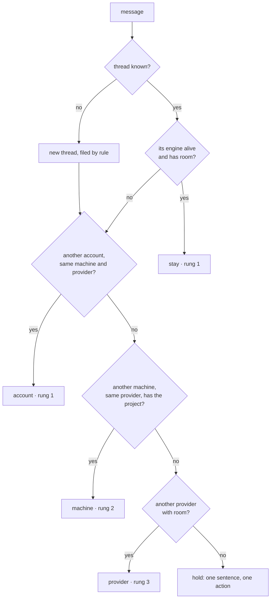

# 06 · Dispatch

When a message arrives, the dispatcher decides which thread it belongs to and which engine takes the turn. It is
plain code and a table: no model is called, the same inputs always give the same answer, and every decision is
written in the journal with the facts it used. The user chooses nothing and sees nothing, except when no engine at
all can work.



## A worked example

The reference scenario: a phone, a laptop and a server; three Claude accounts and one Codex account; several threads
at work. At 13:53 the thread "Add CSV export to orders" loses its engine mid-turn (its account reaches the limit).
The engine table then reads:

| Engine | Signed in | 5 h | Week | Reserved | Seen | Threads at work |
|---|---|---|---|---|---|---|
| `claude:a3f9c1@laptop` | yes | 100 %, resets 17:00 | 41 % | 0 | 13:53:40 | — |
| `claude:a3f9c1@server` | yes | 100 % (same account) | 41 % | 0 | 13:53:38 | — |
| `claude:7b20d4@server` | yes | 64 % | 88 % | 30 | 13:53:38 | 3 |
| `claude:e91f55@laptop` | **no** (signed out) | — | — | — | 13:53:40 | — |
| `codex:c81d2e@laptop` | yes | 8 % | 15 % | 0 | 13:53:40 | — |

Row by row of the decision table: **stay** fails (a3f9c1 is at its limit). **account** fails: on the laptop the only
other Claude account is signed out. **machine** fails: on the server, a3f9c1 is the same exhausted account, and
7b20d4 is at 64 + 30 reserved = 94 %, above the 85 % a thread needs to enter. **provider** matches. The journal gets:

```json
{"v":1,"seq":27,"id":"…","at":"2026-11-18T13:53:46Z","leg":null,"type":"turn","turn":2,"state":"assigned","engine":"codex:c81d2e@laptop","attempt":2,"resume":true,"rule":"provider","reason":"claude a3f9c1 is at its 5-hour limit until 17:00 UTC; no other claude engine has room; codex c81d2e is at 8 %"}
```

At 14:20 the next message of that thread arrives. Claude a3f9c1 is still at its limit: **stay** on Codex. At 17:05
the window has reset, but **stay** still matches first: the thread keeps the engine that works.

## Which thread

1. The message names its thread (sent from an open thread in the app, or `thread` in a connector call): that one.
2. A connector call with a `conversation` whose keys are already in a journal: that thread ([05](05-connector.md)).
3. Otherwise a new thread. Its project is, in this order: the project of the folder it was started in; a project
   or repository name that appears in the text (the rule of `server/classify.ts`); none (`_unsorted`).

Filing by a model may happen later, in the background, and writes a `meta` event. It is never on the path of a
message.

## The engine table

Each machine publishes what it knows about itself in `engines.json`, the single file of `refs/engines/<machine>`
([03](03-sync-and-lease.md)). The table is the union of these files.

| Field | Meaning |
|---|---|
| `machine`, `seen` | The machine id and when it last wrote this file. It rewrites it on every change and at least every 60 s. |
| `projects` | The repositories present on the machine, by origin without credentials, and folders without git by name. |
| `engines[].engine` | `<provider>:<account>@<machine>`. |
| `engines[].signedIn` | Whether that account is signed in **on this machine**. Sign-ins never travel; an account is an engine only where it is signed in. |
| `engines[].quota` | `readAt`, and for the 5-hour and weekly windows: `used` (percent) and `resetsAt`. Quota belongs to the account: two engines of one account show the same figures. |
| `engines[].threads` | The threads this engine holds a `working` lease for. |

The dispatcher runs on the machine that serves the app (one per install). It adds two things of its own:

- **Alive**: `seen` is less than 180 s old, or the machine answers the dispatcher directly. A direct call that
  fails after the last `seen` makes the machine not alive until it writes `engines.json` again.
- **Ages by the dispatcher's own clock.** The age of `seen` and of a quota reading is the time since the dispatcher
  first read that version of `engines.json` (or made the reading itself), on its own clock, as for leases
  ([03](03-sync-and-lease.md)). `seen` is written by the machine's clock: compared with the dispatcher's, a laptop
  four minutes ahead stayed "alive" for seven minutes after it went away, and the failed direct calls, older than its
  `seen`, did not count. The simulator found it. After a restart the dispatcher reads every file again as of then.
  `resetsAt` is the provider's own time and is used as it is.
- **Reservations**: a ledger kept by the dispatcher, per account. Assigning a turn reserves 10 points of the 5-hour
  window for that thread on that account (20 when the engine must reread a long thread: any change of account, and a
  new thread that already has messages). The reservation ends when the quota is read again more than a minute after
  it was made, or when the turn ends (done, failed or held).
- **Reservations never pass 100 %.** A reservation is cut to what is left of the window: 100 − `used` − the
  account's reservations. Without the cut, a thread that stays at 96 % would reserve up to 106 % (DISP-6). They count
  on the 5-hour window only; the week is read as it is.

An account **has room** when, for both windows, `used` + its reservations is under the threshold of the row. A quota
reading older than 5 minutes is read again before the table is used. "The most room" is the lowest of the busier
window: `max(5-hour + reservations, week)`.

## The decision table

First matching row wins. `E` is the engine of the thread's last leg.

| Rule | Condition | Engine chosen | Rung |
|---|---|---|---|
| `back` | Not a retry; `E`'s provider is not the thread's first; the thread finished at least **2** turns since it last changed provider; an engine of the first provider is alive, has the project, and its account is under **50 %** on both windows. | the engine of the first provider's last leg; else the same account; else the most room | 1 or 2 if that provider's session exists (same machine, other machine), else 3 |
| `stay` | `E` is alive, signed in, and its account is under **97 %**. | `E` | 1 |
| `account` | `E`'s machine is alive; another account of the same provider is signed in there, under **85 %**. | that account on the same machine; several: the one with the most room | 1 |
| `machine` | Another machine is alive, has the project (or can clone it), has an account of the same provider under **85 %**, and the thread's last checkpoint is not `kind: none`. | several: `E`'s account first, then the most room | 2 |
| `provider` | An engine of another provider is alive, on a machine that has the project, under **85 %**. | `E`'s machine first, then the most room | 3; 1 or 2 when the thread already has a session of that provider (on that machine, on another) |
| `hold` | None of the above. | none | — |
| `new` | The thread has no leg yet. | The rows above without `E`: machines that have the project; the install's preferred provider first; the account with the most room. | 0, or 3 when the thread already has messages |

Ties are broken by engine id in alphabetical order, so the answer never depends on timing. `back` is checked before
`stay`: it is the only row that leaves an engine that works, and only between turns. With `kind: none` (the code
cannot travel), every row keeps to `E`'s machine. `dispatch.ts` implements this table as `decide`, a pure function.

Rules about changing (the reference scenario's "staying is cheap, changing costs"):

- **Only between turns.** The table is consulted when a turn is accepted and when a turn has failed. A running turn
  is never moved.
- **Two thresholds.** A thread stays up to 97 % but enters a new account only under 85 %. An account at 90 % keeps
  its threads and takes no new one.
- **Going back.** A thread on rung 3 returns to its first provider only when that provider's account is under
  **50 %** on both windows, the thread has finished at least 2 turns where it is, and a turn has just ended. A
  window that has barely reset does not pull threads back. This is the row `back`, and the only voluntary change of
  provider: DISP-5 binds it. A forced move (row `provider`, because the current provider has no engine left) may go
  back to the first provider at once; it then resumes its old session (RESUME-6).
- **Compact before a costly move.** A move of account or machine makes the new engine reread the whole provider
  session. When it is over 2 MiB of raw, the provider's own compaction runs at the end of the turn before
  the move. (Not settled: the move is decided at the next turn, after the previous turn ended; "the turn before the
  move" can only be the next turn's start, on the new engine. Not in `decide`, not simulated.)
- **Spread.** Reservations make two threads that fail in the same second pick different accounts when both have
  room.
- **Same provider first (decision D4).** `account` and `machine` come before `provider`. The other order would
  save quota and cost quality at every change.

### When nothing matches

`hold` writes `turn` `held` with one of these reasons. Only then does the user read a sentence, with one action:

| `reason` | The app says | Action |
|---|---|---|
| `no-machine` | None of your machines is on. | Shows which machine has the project. |
| `no-room` | Every account is at its limit until 17:00. | "Tell me when it starts again." |
| `not-signed-in` | Claude is signed out on laptop. | Opens the sign-in. |
| `only-there` | This one can only continue on laptop, which is off. | — |
| `attempts` | It failed three times on an error of its own (`api` or `auth`). | "Try again." |

A held turn is assigned as soon as the table gives an engine: the dispatcher looks again whenever the engine table
changes, and at least every 60 s. When the table gives another reason, the turn is held again with it, so the
sentence the app shows stays true.

## Invariants

To be tested row by row at step 4, and by the simulator: fake engines, the reference scenario, thousands of runs
with random failures (quota gone mid-turn, machine cut, network cut, machine back).

- **DISP-1** The decision is a pure function of the thread's journal, the engine table, the reservations and the
  time. No model call, no randomness.
- **DISP-2** Every `assigned` and `held` event carries the `rule` that matched and a `reason` that states the facts
  used.
- **DISP-3** The engine chosen is alive, signed in on its machine, and has room at the row's threshold.
- **DISP-4** The engine changes only at `accepted` or after `failed`; never while a turn is `running`.
- **DISP-5** After a change of provider, no change back before 2 finished turns and a first provider under 50 %.
- **DISP-6** For one account, the sum of reservations never takes it past 100 % of a window.
- **DISP-7** Simulator, after every run: every accepted message is in exactly one thread, exactly once.
- **DISP-8** Simulator: no turn has two `assistant` answers from two engines.
- **DISP-9** Simulator: every turn ends `done` or `held` with a reason; none stays `accepted`, `assigned`, `running`
  or `failed` once the system is quiet. A held turn's reason is the one the table gives at that moment.
- **DISP-10** The app shows a sentence about engines only for a `held` turn.

## Failure cases

| What happens | Result |
|---|---|
| The quota figures are stale and wrong | The engine refuses on its first request: `failed` with `effect: none`, the quota is read again, the table runs again ([04](04-resume.md)). |
| Three threads lose the same account at once | The first reserves on the best account; the next ones see the reservation and spread. |
| The chosen machine dies before the turn starts | It never took the lease: nothing was written, and the dispatcher decides again 30 s later. `assigned` and `running` are written in the push that takes the lease ([03](03-sync-and-lease.md)); once there, the turn is `running` and a steal fails it with `effect: some`. |
| The dispatcher's machine is off | Messages from the app cannot arrive at all: the app says it cannot reach weevils. Engines at work finish their turns. |
| An account is signed in on no machine that has the project | `hold` with `not-signed-in`. |
| Two engines of the same account on two machines | They share one quota and one reservation ledger entry. |

## What exists today

- `server/relay.ts` is a dispatcher for one case. It watches Claude's quota (`PREPARE_AT = 90`, `SWITCH_AT = 97`,
  read every 5 minutes), and moves work to Codex. The 97 % and the 5 minutes above are its values. It has three
  user-visible modes (ask, automatic, never) and a threshold setting; this design has neither.
- `server/claude-accounts.ts` rotates to "the next account with room" (`rotate()`), with one active account for the
  whole machine. Here the account is chosen per thread.
- `server/provider.ts` holds the install's preferred provider (`preferredTool`) and whether each is signed in
  (`providerStatus`). `server/usage.ts` reads the quota windows (`QuotaInfo` in `shared/infra.ts`).
- `server/classify.ts`: its first stage (`ruleMatch`) is the filing rule used here. Its second stage calls a model
  and is therefore kept off the path of a message.
- `server/remotes.ts` already tells the main machine within seconds that another machine stopped answering.
- [`server/weevbook/dispatch.ts`](../../server/weevbook/dispatch.ts): the decision table (`decide`), the ledger
  (`reserve`, `release`, `settle`) and the thread's facts from its journal (`threadFacts`). `dispatch.test.ts` has a
  test per row and the worked example above. Nothing in the app uses it yet.
- [`server/weevbook/sim`](../../server/weevbook/sim): the simulator below.
- No engine table is published by any machine yet.

## The simulator

`npm run sim -- --seeds 20000` runs 20,000 random runs and prints a summary; `--seed <n> --trace` replays one run
step by step; `--reference` runs the reference scenario. A run is drawn from its seed only, so any failing seed is
replayed from its number. `sim.test.ts` runs the reference scenario and 2,000 seeds with every `npm test`.

- **The world.** A phone that only sends messages; a laptop and a server, the server holding the hub and the
  dispatcher; three Claude accounts on both machines and Codex on the laptop; quotas that run out in the middle of a
  turn; machines switched off and on, links cut, answers to the phone lost; clocks a few seconds apart, and in one run
  in six minutes apart or drifting by 1 to 3 %. The rules are the real ones: `lease.ts`, `turn.ts`, `dispatch.ts`.
- **The reference scenario.** Four threads at work at once on three accounts, one of them on Codex. The laptop dies
  in the middle of a turn; an account reaches zero in the middle of another; the laptop comes back while the server
  answers the thread it lost.
- **Checked after each run.** DISP-1, DISP-3, DISP-5, DISP-6, DISP-7, DISP-8, DISP-9; SYNC-2 to SYNC-5, SYNC-7,
  SYNC-11, SYNC-12; RESUME-8 (including that a failure never claims less effect than the journal shows); every
  journal against `validateJournal`. And: every change of engine is forced (`E` could not stay) or a `back`; every
  hold is justified (no engine could take the turn); a holder that could renew all along never loses its lease
  while clocks are within 30 s.
- **Results** (20,000 seeds, about 10,700 simulated hours): no violation. Steals came at most 128 s after the last
  renewal; none took a lease from a holder that could still renew, with any clock; every orphan came back as a note;
  at most 6 engine changes in one thread.

## Not in v1

- More than one dispatcher (two machines both serving the app).
- Choosing an engine by price, speed or model quality.
- Using someone else's account. Accounts are the user's own.
- Moving a turn while it runs.
- Learning the cost of a turn from history: reservations are fixed numbers at first.
