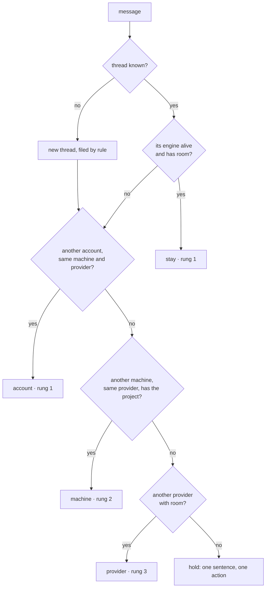

# 06 · Dispatch

When a message arrives, the dispatcher decides which thread it belongs to and which engine takes the turn. It is
plain code and a table: no model is called, the same inputs always give the same answer, and every decision is
written in the journal with the facts it used. The user chooses nothing and sees nothing, except when no engine at
all can work.



## A worked example

The reference scenario: a phone, a laptop and a server; three Claude accounts and one Codex account; several threads
at work. At 13:53 the thread "Add CSV export to orders" loses its engine mid-turn (its account reaches the limit).
The engine table then reads:

| Engine | Signed in | 5 h | Week | Reserved | Seen | Threads at work |
|---|---|---|---|---|---|---|
| `claude:a3f9c1@laptop` | yes | 100 %, resets 17:00 | 41 % | 0 | 13:53:40 | — |
| `claude:a3f9c1@server` | yes | 100 % (same account) | 41 % | 0 | 13:53:38 | — |
| `claude:7b20d4@server` | yes | 64 % | 88 % | 30 | 13:53:38 | 3 |
| `claude:e91f55@laptop` | **no** (signed out) | — | — | — | 13:53:40 | — |
| `codex:c81d2e@laptop` | yes | 8 % | 15 % | 0 | 13:53:40 | — |

Row by row of the decision table: **stay** fails (a3f9c1 is at its limit). **account** fails: on the laptop the only
other Claude account is signed out. **machine** fails: on the server, a3f9c1 is the same exhausted account, and
7b20d4 is at 64 + 30 reserved = 94 %, above the 85 % a thread needs to enter. **provider** matches. The journal gets:

```json
{"v":1,"seq":27,"id":"…","at":"2026-11-18T13:53:46Z","leg":null,"type":"turn","turn":2,"state":"assigned","engine":"codex:c81d2e@laptop","attempt":2,"resume":true,"rule":"provider","reason":"claude a3f9c1 is at its 5-hour limit until 17:00 UTC; no other claude engine has room; codex c81d2e is at 8 %"}
```

At 14:20 the next message of that thread arrives. Claude a3f9c1 is still at its limit: **stay** on Codex. At 17:05
the window has reset, but **stay** still matches first: the thread keeps the engine that works.

## Which thread

1. The message names its thread (sent from an open thread in the app, or `thread` in a connector call): that one.
2. A connector call with a `conversation` whose keys are already in a journal: that thread ([05](05-connector.md)).
3. Otherwise a new thread. Its project is, in this order: the project of the folder it was started in; a project
   or repository name that appears in the text (the rule of `server/classify.ts`); none (`_unsorted`).

Filing by a model may happen later, in the background, and writes a `meta` event. It is never on the path of a
message.

## The engine table

Each machine publishes what it knows about itself in `engines.json`, the single file of `refs/engines/<machine>`
([03](03-sync-and-lease.md)). The table is the union of these files.

| Field | Meaning |
|---|---|
| `machine`, `seen` | The machine id and when it last wrote this file. It rewrites it on every change and at least every 60 s. |
| `projects` | The repositories present on the machine, by origin without credentials, and folders without git by name. |
| `engines[].engine` | `<provider>:<account>@<machine>`. |
| `engines[].signedIn` | Whether that account is signed in **on this machine**. Sign-ins never travel; an account is an engine only where it is signed in. |
| `engines[].quota` | `readAt`, and for the 5-hour and weekly windows: `used` (percent) and `resetsAt`. Quota belongs to the account: two engines of one account show the same figures. |
| `engines[].threads` | The threads this engine holds a `working` lease for. |

The dispatcher runs on the machine that serves the app (one per install). It adds two things of its own:

- **Alive**: `seen` is less than 180 s old, or the machine answers the dispatcher directly.
- **Reservations**: a ledger kept by the dispatcher, per account. Assigning a turn reserves 10 points of the 5-hour
  window for that thread on that account (20 when the engine must reread a long thread: any change of account). The
  reservation ends when the quota is read again after the turn's first minute, or when the turn ends.

An account **has room** when, for both windows, `used` + its reservations is under the threshold of the row. A quota
reading older than 5 minutes is read again before the table is used.

## The decision table

First matching row wins. `E` is the engine of the thread's last leg.

| Rule | Condition | Engine chosen | Rung |
|---|---|---|---|
| `stay` | `E` is alive, signed in, and its account is under **97 %**. | `E` | 1 |
| `account` | `E`'s machine is alive; another account of the same provider is signed in there, under **85 %**. | that account on the same machine; several: the one with the most room | 1 |
| `machine` | Another machine is alive, has the project (or can clone it), has an account of the same provider under **85 %**, and the thread's last checkpoint is not `kind: none`. | several: `E`'s account first, then the most room | 2 |
| `provider` | An engine of another provider is alive, on a machine that has the project, under **85 %**. | `E`'s machine first, then the most room | 3 |
| `hold` | None of the above. | none | — |
| `new` | The thread has no leg yet. | The rows above without `E`: machines that have the project; the install's preferred provider first; the account with the most room. | 0, or 3 when the thread already has messages |

Ties are broken by engine id in alphabetical order, so the answer never depends on timing.

Rules about changing (the reference scenario's "staying is cheap, changing costs"):

- **Only between turns.** The table is consulted when a turn is accepted and when a turn has failed. A running turn
  is never moved.
- **Two thresholds.** A thread stays up to 97 % but enters a new account only under 85 %. An account at 90 % keeps
  its threads and takes no new one.
- **Going back.** A thread on rung 3 returns to its first provider only when that provider's account is under
  **50 %** on both windows, the thread has finished at least 2 turns where it is, and a turn has just ended. A
  window that has barely reset does not pull threads back.
- **Compact before a costly move.** A move of account or machine makes the new engine reread the whole provider
  session. When it is over 2 MiB of raw, the provider's own compaction runs at the end of the turn before
  the move.
- **Spread.** Reservations make two threads that fail in the same second pick different accounts when both have
  room.
- **Same provider first (decision D4).** `account` and `machine` come before `provider`. The other order would
  save quota and cost quality at every change.

### When nothing matches

`hold` writes `turn` `held` with one of these reasons. Only then does the user read a sentence, with one action:

| `reason` | The app says | Action |
|---|---|---|
| `no-machine` | None of your machines is on. | Shows which machine has the project. |
| `no-room` | Every account is at its limit until 17:00. | "Tell me when it starts again." |
| `not-signed-in` | Claude is signed out on laptop. | Opens the sign-in. |
| `only-there` | This one can only continue on laptop, which is off. | — |
| `attempts` | It stopped three times in a row. | "Try again." |

A held turn is assigned as soon as the table gives an engine: the dispatcher looks again whenever the engine table
changes.

## Invariants

To be tested row by row at step 4, and by the simulator: fake engines, the reference scenario, thousands of runs
with random failures (quota gone mid-turn, machine cut, network cut, machine back).

- **DISP-1** The decision is a pure function of the thread's journal, the engine table, the reservations and the
  time. No model call, no randomness.
- **DISP-2** Every `assigned` and `held` event carries the `rule` that matched and a `reason` that states the facts
  used.
- **DISP-3** The engine chosen is alive, signed in on its machine, and has room at the row's threshold.
- **DISP-4** The engine changes only at `accepted` or after `failed`; never while a turn is `running`.
- **DISP-5** After a change of provider, no change back before 2 finished turns and a first provider under 50 %.
- **DISP-6** For one account, the sum of reservations never takes it past 100 % of a window.
- **DISP-7** Simulator, after every run: every accepted message is in exactly one thread, exactly once.
- **DISP-8** Simulator: no turn has two `assistant` answers from two engines.
- **DISP-9** Simulator: every turn ends `done` or `held` with a reason; none stays `accepted`, `assigned`, `running`
  or `failed` once the system is quiet.
- **DISP-10** The app shows a sentence about engines only for a `held` turn.

## Failure cases

| What happens | Result |
|---|---|
| The quota figures are stale and wrong | The engine refuses on its first request: `failed` with `effect: none`, the quota is read again, the table runs again ([04](04-resume.md)). |
| Three threads lose the same account at once | The first reserves on the best account; the next ones see the reservation and spread. |
| The chosen machine dies between `assigned` and `running` | It never took the lease, or took it and stopped renewing. Either way the turn is `failed` (`effect: none`) and assigned again. |
| The dispatcher's machine is off | Messages from the app cannot arrive at all: the app says it cannot reach weevils. Engines at work finish their turns. |
| An account is signed in on no machine that has the project | `hold` with `not-signed-in`. |
| Two engines of the same account on two machines | They share one quota and one reservation ledger entry. |

## What exists today

- `server/relay.ts` is a dispatcher for one case. It watches Claude's quota (`PREPARE_AT = 90`, `SWITCH_AT = 97`,
  read every 5 minutes), and moves work to Codex. The 97 % and the 5 minutes above are its values. It has three
  user-visible modes (ask, automatic, never) and a threshold setting; this design has neither.
- `server/claude-accounts.ts` rotates to "the next account with room" (`rotate()`), with one active account for the
  whole machine. Here the account is chosen per thread.
- `server/provider.ts` holds the install's preferred provider (`preferredTool`) and whether each is signed in
  (`providerStatus`). `server/usage.ts` reads the quota windows (`QuotaInfo` in `shared/infra.ts`).
- `server/classify.ts`: its first stage (`ruleMatch`) is the filing rule used here. Its second stage calls a model
  and is therefore kept off the path of a message.
- `server/remotes.ts` already tells the main machine within seconds that another machine stopped answering.
- No engine table, no reservations and no simulator exist.

## Not in v1

- More than one dispatcher (two machines both serving the app).
- Choosing an engine by price, speed or model quality.
- Using someone else's account. Accounts are the user's own.
- Moving a turn while it runs.
- Learning the cost of a turn from history: reservations are fixed numbers at first.
