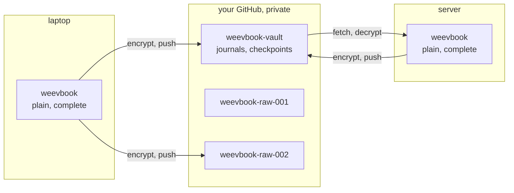

# 07 · Vault: every conversation, kept on your GitHub

**Status: design, being built.** This page settles D1 and D2 of [03](03-sync-and-lease.md#open-decisions) the way the
owner chose on 2026-11-21: the hub of every install is the person's own GitHub, encrypted, whether they have no
server, one, or ten. The owner took the recommended answer to the four decisions at the end (2026-11-21). The person
feels only what they must: one GitHub sign-in, the recovery code once, the history question, and agreed moves.

## What it is for, in order

1. **Ownership, retroactive.** Someone installs weevils today and finds every conversation they had with Claude Code
   and Codex, on every machine, with every account, before weevils existed. From then on nothing is lost: not when a
   machine dies, not when a subscription ends, not when a provider deletes its files after 30 days.
2. **Conservation for agents, not for reading.** What is kept is what an agent needs to continue a conversation: the
   journal, the provider's own lines with the thinking, and the state of the code. Nobody reads it on github.com.
3. **Moving work, on request.** A conversation continues on another machine or account when the person says so, or
   when weevboss proposes it in one line and the person agrees ("the server has been silent for 12 minutes: continue
   this on the laptop?"). Changing the Claude account on the same machine needs none of this page.

## The picture



Each machine keeps its own weevbook as today ([02](02-weevbook.md)): plain, readable, complete. The **vault** is the
copy on GitHub: the same threads, encrypted, in the person's own private repositories. It replaces the hub on a
machine (`WEEVILS_WEEVBOOK_HUB=here`). No machine is special any more: any machine can die and the vault has
everything; a new machine fetches the vault and has everything.

## What goes where

| | On each machine | In the vault |
|---|---|---|
| Journals (`events.jsonl`), titles, projects | all threads | all threads |
| Checkpoints of the code | the threads it ran | all threads |
| Raw lines, full | the threads it ran, and those it resumed | no |
| Raw lines, **slim** | — | all threads |
| Attachments | the threads it ran | all threads |
| `thread.md`, `handoff.md`, `index.json` | rebuilt from the journal | no (rebuilt) |

**Slim raw.** Measured on the owner's server (2026-11-21, ~600 threads, two weeks): 1,083 MB of Claude raw lines, of
which 575 MB are tool results over 20 KB and the `toolUseResult` copies Claude Code keeps next to them; the thinking
is 26 MB. Slim raw is the raw with exactly two cuts: a tool result over 20 KB keeps its first and last 8 KB with a
marker between (`[… 412 KB kept on <machine> …]`), and `toolUseResult` objects over 2 KB are dropped (the model never
reads them). Everything else is kept byte for byte, thinking blocks and their signatures included. A provider resumes
from slim raw: the model sees a long command output shortened, the way a person would scroll past it.

## The format on GitHub

Encryption is per file, not per repository: the lease needs GitHub to see real refs and commits
([03, D2](03-sync-and-lease.md#open-decisions)). And per **immutable chunk**, not per file: an encrypted file that
changes is a new blob each time with no delta, so a journal re-encrypted at every turn would grow the repository by
its whole size each time.

```
weevbook-vault                         refs/threads/<thread id>  → a commit whose tree is:
  m                                    the manifest: ordered list of chunk names, encrypted (small)
  c/<sha256>                           one chunk: events appended in one push, zstd, encrypted
  a/<sha256>                           one attachment, encrypted
                                       refs/leases/<thread id>   → lease.json, encrypted
                                       refs/checkpoints/<thread id> → an encrypted git bundle of the turn
                                       refs/heads/main           → only a README (what this is, no data)

weevbook-raw-NNN                       refs/raw/<thread id>      → m + c/<sha256>, slim raw chunks
```

- A push adds the chunks of what is new and a new manifest. Nothing already pushed changes.
- Names say nothing: thread ids are ULIDs (they show a creation time, nothing else); chunk names are hashes of the
  ciphertext. No title, project, machine or account name leaves in clear. `main` with its titled folders is never
  pushed.
- Encryption: one 32-byte **vault key**, AES-256-GCM (Node's own `crypto`), a random 12-byte nonce per file, the
  thread id as associated data (a chunk moved to another thread fails to decrypt). The plain text is zstd-compressed
  first (measured: 3.3× on raw lines).
- Raw repositories: a new `weevbook-raw-NNN` when the current one passes 700 MB, under GitHub's 1 GB recommendation.
  At the owner's pace (≈ 25 MB of slim compressed raw a day) that is one repository every month or so. The vault
  itself grows by ≈ 1 MB a day.

## Access to GitHub

The person connects GitHub once, in the chat with weevboss (`gh auth login` on the first machine, the device-code
flow: a code to type on github.com). With it, weevils creates the private repositories and gives **each machine its
own deploy key** with write access to those repositories only. The `gh` token itself is not kept for the vault.

- A machine joined with one line ([install, several machines](../install.md#several-machines)) gets its deploy key from the main machine in the same
  exchange, and pushes to GitHub directly. The joined machine's narrow SSH key to the server stays as it is: it no
  longer needs to reach any hub there.
- A new raw repository gets every machine's key when it is created.
- Removing a machine removes its deploy keys.

## The vault key

It is made on the first machine and given to each machine when it joins (inside the one-line exchange, which already
carries a one-time secret over HTTPS). It lives in `~/.config/weevils/vault.key` (0600). Lose every machine and the
vault is unreadable, so weevboss gives the person a **recovery code** once, when the vault is created: the key as 24
words, with one sentence ("Keep this somewhere safe, like a password: with it, a new machine gets everything back").
A new install that finds an existing vault on the person's GitHub asks for it, in the chat.

## The history: retroactive import

On every machine, at install or join, with no question:

1. The writer is on (`WEEVILS_WEEVBOOK` defaults to 1).
2. `weevils weevbook backfill` runs once in the background, at low priority, over every Claude Code and Codex session
   still on the machine. The machine's weevbook then pushes it to the vault, oldest last.

Then weevboss says, in the person's language, once the server is ready to carry their work:

> Your server is ready to carry your work. Want me to bring over your whole history, or do you have a date or a few
> conversations in mind?

- "Everything": nothing more to do on this machine; for another computer, weevboss gives the one line to paste
  there, and that machine imports its own history.
- A date or a few conversations: the backfill of the other computer takes `--since <date>` or `--match <words>`.
- Claude.ai and ChatGPT: weevboss offers the official export, which weevils already imports.

When the import is done:

> Done: 412 conversations from your MacBook and this server, across two Claude accounts and Codex. From today they're
> yours, not Claude's, not OpenAI's, not any one machine's. They live in your private GitHub, and you can reopen and
> continue any of them right here. Machines and subscriptions come and go; your work stays. You're independent now.

Claude Code deletes its own sessions after 30 days by default (`cleanupPeriodDays`): weevboss says "the last 30
days" when that is all there is, never "everything".

## A new machine

It fetches the vault and decrypts every journal into its weevbook: the whole history is in the app at once (≈ 30 MB
for the owner's two weeks). Raw lines and checkpoints are fetched only for a thread it resumes.

## Moving a conversation

The lease of [03](03-sync-and-lease.md) works on GitHub as it is (atomic multi-ref push, compare-and-swap with
`--force-with-lease`). Two changes, both from the owner's decision that switches are rare and agreed:

- **Slower lease.** Renewed every 5 minutes instead of 20 seconds; a working machine's pushes after each turn renew
  it too. Measured cost: at most 12 pushes an hour per working thread.
- **No silent steal.** A lease that stops being renewed makes weevboss propose the move in one line; the steal of
  [03](03-sync-and-lease.md) runs when the person agrees, or when they themselves say "continue this on the laptop".
  Everything after the steal is unchanged ([04](04-resume.md)).

The dispatcher of [06](06-dispatch.md) keeps its table; its automatic moves become proposals with the same reason
line. A direct order ("send this to Claude on vps-1", "use two accounts and three servers for this") skips the
proposal: it is the agreement.

## Invariants

- **VAULT-1** No byte pushed to GitHub, outside `main`'s README, is readable without the vault key: a test pushes a
  weevbook with known titles, paths, commands and secrets, then searches every object of the remote for them.
- **VAULT-2** Every machine lost, recovery code kept: a new machine gets back every journal, every checkpoint, every
  slim raw line, byte for byte against the old machines' copies (slim raw against the slim of their raw).
- **VAULT-3** A push never rewrites a chunk: the objects of the remote only grow by the new turn's chunks.
- **VAULT-4** A Claude session rebuilt from slim raw resumes, and its thinking blocks reach the API unchanged.
- **VAULT-5** A backfill run twice pushes nothing the second time.
- **VAULT-6** No lease is stolen without the person's agreement or order.
- **VAULT-7** Each repository stays under 1 GB.

VAULT-4 needs one check first: redaction ([02](02-weevbook.md#redaction)) runs over every string of a raw line,
thinking included. A thinking block whose text redaction changed fails its signature on resume. Redaction must skip
`thinking` and `signature` values; what a thinking block says stays encrypted in the vault instead.

## Steps

1. **Vault writer.** Encrypt and push journals, chunks and attachments; the import at install; the recovery code.
   The plain hub on a machine keeps working beside it for existing installs.
2. **A new machine from the vault**, and the onboarding question and summary in weevboss's chat.
3. **Slim raw and checkpoints in the vault**, and resuming a thread from them (VAULT-4).
4. **Lease on GitHub**, weevboss's proposals, direct orders.

## Decisions (taken 2026-11-21: the recommended answer to each)

**V1 · Recovery code.** *Recommended:* weevboss gives it once, as 24 words. *Other:* no recovery code (lose every
machine, lose the vault); or the key on GitHub, encrypted with a passphrase the person chooses.

**V2 · Raw lines on GitHub.** *Recommended:* slim (about half the size, resumes the same). *Other:* full raw (twice the
repositories, every output kept); or no raw (a new machine resumes from the handoff only, losing the thinking).

**V3 · GitHub access.** *Recommended:* one deploy key per machine, limited to the vault's repositories. *Other:* the
person's `gh` token on every machine (simpler, but a stolen machine reaches all their repositories).

**V4 · A machine that goes silent.** *Recommended:* weevboss proposes the move, the person agrees. *Other:* automatic
after a delay the person sets.

## What exists today

- [`server/weevbook/hub.ts`](../../server/weevbook/hub.ts), [`lease.ts`](../../server/weevbook/lease.ts): the sync
  and the lease, over any git remote. The vault adds encryption between the weevbook and the remote.
- [`server/weevbook/backfill.ts`](../../server/weevbook/backfill.ts): the import of a machine's sessions, run by hand
  today (`weevils weevbook backfill`).
- [`server/weevbook/redact.ts`](../../server/weevbook/redact.ts): `redactRawLine`, which VAULT-4 changes.
- [`server/join.ts`](../../server/join.ts): the one-line join, which will carry the vault key and the deploy key.
- [`server/conversations.ts`](../../server/conversations.ts): the import of Claude.ai and ChatGPT exports.
