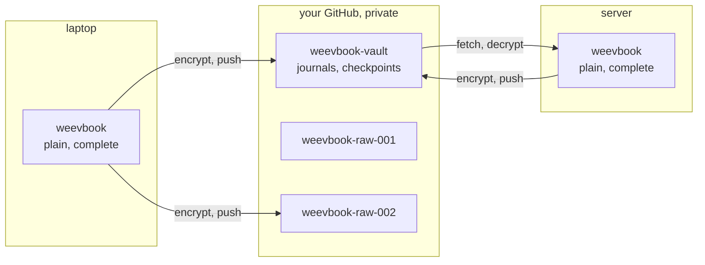

# 07 · Vault: every conversation, kept on your GitHub

**Status: steps 1 to 4 built** (`server/weevbook/vault.ts`, `vault-raw.ts`, `slim.ts`, `vault-cli.ts`,
`vault-github.ts`, `vault-lease.ts`, `proposals.ts`, `move-cli.ts`, `server/moves-app.ts`; `vault.test.ts`,
`vault-raw.test.ts`, `vault-lease.test.ts`, `slim.test.ts`, `server/join.test.ts`): journals, attachments
and handoffs, the recovery code, the import at install and its choices, the join that carries the vault, a new machine
from the vault, the summary, the onboarding in weevboss's chat, since step 3 the raw lines (slim), the checkpoints
of the code, the access every machine gets to the raw repositories, and a thread resumed from the vault on a machine
that never ran it, and since step 4 the lease on the vault, weevboss's proposals and the person's direct orders. This page settles D1 and D2 of [03](03-sync-and-lease.md#open-decisions) the way the
owner chose on 2026-11-21: the hub of every install is the person's own GitHub, encrypted, whether they have no
server, one, or ten. The owner took the recommended answer to the four decisions at the end (2026-11-21). The person
feels only what they must: one GitHub sign-in, the recovery code once, the history question, and agreed moves.

## What it is for, in order

1. **Ownership, retroactive.** Someone installs weevils today and finds every conversation they had with Claude Code
   and Codex, on every machine, with every account, before weevils existed. From then on nothing is lost: not when a
   machine dies, not when a subscription ends, not when a provider deletes its files after 30 days.
2. **Conservation for agents, not for reading.** What is kept is what an agent needs to continue a conversation: the
   journal, the provider's own lines with the thinking, and the state of the code. Nobody reads it on github.com.
3. **Moving work, on request.** A conversation continues on another machine or account when the person says so, or
   when weevboss proposes it in one line and the person agrees ("the server has been silent for 12 minutes: continue
   this on the laptop?"). Changing the Claude account on the same machine needs none of this page.

## The picture



Each machine keeps its own weevbook as today ([02](02-weevbook.md)): plain, readable, complete. The **vault** is the
copy on GitHub: the same threads, encrypted, in the person's own private repositories. It replaces the hub on a
machine (`WEEVILS_WEEVBOOK_HUB=here`). No machine is special any more: any machine can die and the vault has
everything; a new machine fetches the vault and has everything.

## What goes where

| | On each machine | In the vault |
|---|---|---|
| Journals (`events.jsonl`), titles, projects | all threads | all threads |
| Checkpoints of the code | the threads it ran | all threads |
| Raw lines, full | the threads it ran, and those it resumed | no |
| Raw lines, **slim** | — | all threads |
| Attachments | the threads it ran | all threads |
| `thread.md`, `index.json` | rebuilt from the journal | no (rebuilt) |
| `handoff.md` | the threads that have one | all threads that have one (step 2: a model writes it and the journal keeps only its SHA-256, so it cannot be rebuilt) |

**Slim raw.** Measured on the owner's server (2026-11-21, ~600 threads, two weeks): 1,083 MB of Claude raw lines, of
which 575 MB are tool results over 20 KB and the `toolUseResult` copies Claude Code keeps next to them; the thinking
is 26 MB. Slim raw is the raw with exactly two cuts: a tool result over 20 KB keeps its first and last 8 KB with a
marker between (`[… 412 KB kept on <machine> …]`), and `toolUseResult` objects over 2 KB are dropped (the model never
reads them). Everything else is kept byte for byte, thinking blocks and their signatures included. A provider resumes
from slim raw: the model sees a long command output shortened, the way a person would scroll past it.

As built (`server/weevbook/slim.ts`, step 3):

- **A line that is not cut is the identical bytes.** A line that is cut is spliced as text, never parsed and written
  again: only the cut value changes, so a signed block, a uuid or a number next to it keeps every byte. Lines keep
  their order.
- **Claude.** In `message.content`, each `tool_result`: its `content` when it is a string, or each of its `text`
  blocks, over 20 KB. The line's own `toolUseResult` (an object or a list) over 2 KB goes.
- **A picture is not cut in the middle.** Measured again at step 3: of the tool results over 20 KB, 370 MB of 374 are
  pictures (screenshots an agent read), and a base64 picture with its middle removed makes the provider refuse the
  whole conversation. A picture over 20 KB inside a tool result becomes the marker alone, as a text block
  (`[… image, 412 KB kept on <machine> …]`). A picture the person pasted in a message is not a tool result: kept.
- **Codex.** The same first rule on what a tool or a command gave back: `output` of the `custom_tool_call_output` and
  `function_call_output` response items (a string, or its `input_text` and `input_image` items) and
  `aggregated_output` of a completed `CommandExecution`. `reasoning.encrypted_content` and `compacted` lines are
  untouched.
- **The machine named** is the one the leg ran on, as the journal says (`leg.start`).
- Measured on the same server at step 3 (644 threads): 1,157 MB of Claude raw and 343 MB of Codex raw become 495 MB
  and 176 MB slim, 134 MB once compressed.

## The format on GitHub

Encryption is per file, not per repository: the lease needs GitHub to see real refs and commits
([03, D2](03-sync-and-lease.md#open-decisions)). And per **immutable chunk**, not per file: an encrypted file that
changes is a new blob each time with no delta, so a journal re-encrypted at every turn would grow the repository by
its whole size each time.

```
weevbook-vault                         refs/threads/<thread id>  → a commit whose tree is:
  m                                    the manifest: ordered list of chunk names, encrypted (small)
  c/<sha256>                           one chunk: events appended in one push, zstd, encrypted
  a/<sha256>                           one attachment, encrypted
  h                                    handoff.md as the journal last recorded it, encrypted (replaced when rewritten)
                                       refs/leases/<thread id>   → l: lease.json, encrypted (step 4)
                                       refs/checkpoints/<thread id> → m + b/<sha256>: one encrypted git bundle per
                                                                    checkpoint sent, and their manifest
                                       refs/map/raw              → one small encrypted file per write: which raw
                                                                    repository holds which thread, and who may write it
                                       refs/heads/main           → only a README (what this is, no data)

weevbook-raw-NNN                       refs/raw/<thread id>      → m + c/<sha256>, slim raw chunks
```

- A push adds the chunks of what is new and a new manifest. Nothing already pushed changes.
- Names say nothing: thread ids are ULIDs (they show a creation time, nothing else); chunk names are hashes of the
  ciphertext. No title, project, machine or account name leaves in clear. `main` with its titled folders is never
  pushed.
- Encryption: one 32-byte **vault key**, AES-256-GCM (Node's own `crypto`), a random 12-byte nonce per file, the
  thread id as associated data (a chunk moved to another thread fails to decrypt). The plain text is zstd-compressed
  first (measured: 3.3× on raw lines).
- Raw repositories: a new `weevbook-raw-NNN` when the current one passes 700 MB, under GitHub's 1 GB recommendation.
  At the owner's pace (≈ 25 MB of slim compressed raw a day) that is one repository every month or so. The vault
  itself grows by ≈ 1 MB a day.
- **A raw chunk** is, for one raw segment of a thread (`L1.claude.0001.jsonl`), the bytes appended since the last
  push, whole lines only, slim, compressed, sealed. The raw manifest keeps, per segment, how much of the source is in
  the vault (with the hash of the last 64 KB before that point, to recognise it next time) and its chunks in order.
- **The map** (`refs/map/raw`) is what a machine that holds only the vault key and access to the vault's repository
  needs to find a thread's raw lines: one sealed file per write, never rewritten, holding records: a raw repository
  exists; a thread lives in the n-th one (written once, for good: a thread's later lines go where its first went); the
  sealed bytes a machine pushed to the n-th one (how its size is known without asking GitHub: every machine adds up
  what all of them wrote, a line in the map each time a machine's own count moved by 1/32 of the limit); a machine's
  public key for the n-th one, and that key registered. It is pushed on the vault's tip or not at all, and a thread is
  claimed there before its lines are pushed, so two machines never give one thread two repositories.
- **VAULT-7 as built.** New threads are given a repository a window at a time (at most a quarter of the limit of raw
  lines to read); a repository that passed 700 MB takes no new thread. It can end at most a quarter over, plus what
  its threads still write: under 1 GB.
- **A checkpoint bundle** is `git bundle` of the thread's checkpoint ref, without what the bundles before it already
  carry and without what the project's own origin has (the commits where the checkpoint's history meets the origin's
  branches, noted when the checkpoint is taken). A machine that clones the project from its origin applies the
  bundles in order; when its clone is behind the origin, the origin is fetched first. A bundle over 50 MB is not sent:
  the manifest says which machine kept it, and the thread can only continue there (the rule of a checkpoint of `kind:
  none`, [04](04-resume.md#failure-cases)).

## Access to GitHub

The person connects GitHub once, in the chat with weevboss (`gh auth login` on the first machine, the device-code
flow: a code to type on github.com). With it, weevils creates the private repositories and gives **each machine its
own deploy key** with write access to those repositories only. The `gh` token itself is not kept for the vault.

- A machine joined with one line ([install, several machines](../install.md#several-machines)) gets its deploy key from the main machine in the same
  exchange, and pushes to GitHub directly. The joined machine's narrow SSH key to the server stays as it is: it no
  longer needs to reach any hub there.
- Removing a machine removes its deploy keys (not built: nothing removes a machine yet).

**The raw repositories (step 3).** GitHub accepts a deploy key on one repository only ("key is already in use" on a
second), so the vault's key cannot open them. The design, with nothing for the person to do:

1. **One key per machine and per raw repository**: `~/.config/weevils/vault-deploy-raw-NNN`, made by the machine
   itself, the private half never leaving it.
2. **Each machine publishes the public halves in the map**, sealed like everything else: one for every raw repository
   there is, and one for the next. It can always do that: it holds the vault key and its key on the vault's
   repository.
3. **The machine where the person signed in with `gh`** (the vault's owner there) makes `weevbook-raw-NNN` when the
   map has none, or when the last one passed its size, and registers on each raw repository every key the map holds
   for it, with write access (`gh api repos/<owner>/weevbook-raw-NNN/keys`). It writes "exists" and "registered" in
   the map. It does this at every push of its own, and at least every 15 minutes when nothing moves there.
4. **A machine writes a raw repository once the map says its key is registered**, with that key alone. Until then
   its journals and checkpoints go (the vault's repository), its raw lines wait: a machine that just joined waits at
   most those 15 minutes, a new raw repository is writable by every machine the moment it opens (their keys were
   published ahead).
5. A machine with `gh` signed in under another account, or with no `ssh-keygen`, publishes nothing and waits.

A vault kept in a folder (`vault setup --remote /path/to/vault.git`: a disk, a home server's own files, the tests)
needs none of this: the next raw repository is a folder beside it, made by whichever machine needs it. A vault on
another kind of git remote takes journals and checkpoints; its raw lines are not sent (nothing can make the next
repository there).

## The vault key

It is made on the first machine and given to each machine when it joins (inside the one-line exchange, which already
carries a one-time secret over HTTPS). It lives in `~/.config/weevils/vault.key` (0600). Lose every machine and the
vault is unreadable, so weevboss gives the person a **recovery code** once, when the vault is created: the key as 24
words, with one sentence ("Keep this somewhere safe, like a password: with it, a new machine gets everything back").
A new install that finds an existing vault on the person's GitHub asks for it, in the chat.

## The history: retroactive import

On every machine, at install or join, with no question:

1. The writer is on (`WEEVILS_WEEVBOOK` defaults to 1).
2. `weevils weevbook backfill` runs once in the background, at low priority, over every Claude Code and Codex session
   still on the machine. The machine's weevbook then pushes it to the vault, oldest last.

Then weevboss says, in the person's language, once the server is ready to carry their work:

> Your server is ready to carry your work. Want me to bring over your whole history, or do you have a date or a few
> conversations in mind?

- "Everything": nothing more to do on this machine; for another computer, weevboss gives the one line to paste
  there, and that machine imports its own history.
- A date or a few conversations: the backfill of the other computer takes `--since <date>` or `--match <words>`.
- Claude.ai and ChatGPT: weevboss offers the official export, which weevils already imports.

When the import is done:

> Done: 412 conversations from your MacBook and this server, across two Claude accounts and Codex. From today they're
> yours, not Claude's, not OpenAI's, not any one machine's. They live in your private GitHub, and you can reopen and
> continue any of them right here. Machines and subscriptions come and go; your work stays. You're independent now.

Claude Code deletes its own sessions after 30 days by default (`cleanupPeriodDays`): weevboss says "the last 30
days" when that is all there is, never "everything".

## A new machine

It fetches the vault and decrypts every journal into its weevbook: the whole history is in the app at once (≈ 30 MB
for the owner's two weeks). Raw lines and checkpoints are fetched only for a thread it resumes: the map says which raw
repository, that thread's one ref is fetched from it, and its checkpoint ref from the vault; nothing else comes.

## Moving a conversation

The lease of [03](03-sync-and-lease.md) works on GitHub as it is (atomic multi-ref push, compare-and-swap with
`--force-with-lease`). Two changes, both from the owner's decision that switches are rare and agreed:

- **Slower lease.** Renewed every 5 minutes instead of 20 seconds; a working machine's pushes after each turn renew
  it too. Measured cost: at most 12 pushes an hour per working thread.
- **No silent steal.** A lease that stops being renewed makes weevboss propose the move in one line; the steal of
  [03](03-sync-and-lease.md) runs when the person agrees, or when they themselves say "continue this on the laptop".
  Everything after the steal is unchanged ([04](04-resume.md)).

The dispatcher of [06](06-dispatch.md) keeps its table; its automatic moves become proposals with the same reason
line. A direct order ("send this to Claude on vps-1", "use two accounts and three servers for this") skips the
proposal: it is the agreement.

As built (step 4), for machines that share a vault and no hub:

- **The lease on the vault** (`vault-lease.ts`, with `lease.ts` as it is: the same rules, the same pushes). Every push
  of a thread carries its lease, compare-and-swap, in the same atomic push: taken when the thread has none, taken
  over when it is idle, renewed when it is this machine's. It is `working` while the journal shows a turn at work on an
  engine of the pusher's own machine, `idle` otherwise. A thread whose lease another machine holds at work, or took
  meanwhile, is left out of the push and counted (`vault push` says on which machine it continues).
- **What GitHub holds of it.** `refs/leases/<thread id>` → a commit with no parent and one file, `l`: `lease.json`
  sealed like everything else (the vault key, the thread id as associated data, its own kind), in a commit by `vault
  <vault@weevils.invalid>`, dated 2000-01-01, message `vault`. No holder, engine, epoch or state is readable (VAULT-1).
- **The numbers.** Renewed every 5 minutes while its turn runs (weevilsd's pusher; the working leases of one machine
  go in one push), and by each push of the thread. `expires` is `renewed` + 10 minutes. Silent: past `expires` + 30 s
  **and** the same lease commit seen for 10 minutes by the watcher's own clock.
- **The watch.** The machine that serves the app (where weevboss lives) reads the vault's leases every 2 minutes
  while another machine has a turn at work, every 10 otherwise. A working lease gone silent is never taken: it becomes
  a **proposal**. So does a move the dispatcher's table chose (rules `account`, `machine`, `provider`), with the
  table's own reason line; that turn is held (`agreement`) until the answer.
- **Proposals** (`proposals.ts`) live in `DATA_DIR/weevbook-proposals.json`: they survive a restart. One cause is asked
  once: a silence is its lease commit (a machine that came back and went silent again is another silence), a
  dispatcher's move is its rule, thread and turn. Declined, agreed or still open, the same cause never makes a second
  proposal. A proposal whose cause went away before an answer (the machine renewed its lease, the turn could stay
  after all) is withdrawn: a late yes moves nothing.
- **One line, one yes.** weevilsd posts the proposal in weevboss's thread, in weevboss's name and the person's
  language, with a notification: "**laptop** has been silent for 12 min. Shall I continue “Add CSV export” here, on
  server?" (several conversations of one silent machine: one line for all). On the yes weevboss runs `weevils weevbook
  agree`, on the no `weevils weevbook decline`. weevboss's instructions say it never moves anything by itself.
- **The commands** (weevboss runs them; `weevbook` was already in its allowed list):
  `weevils weevbook proposals [--json]` · `agree [<id>]` · `decline [<id>]` (no id: every open one) ·
  `move <session|thread> --to <machine> [--engine claude|codex] [--account <name>] [--force]` · `machines [--json]`.
  Machines are named by their id or name (`WEEVILS_MACHINE`, `WEEVILS_MACHINE_NAME`); a conversation by its thread id
  or by the id of its provider session, as `weevils sessions` shows it.
- **A direct order** is `move`: no proposal. The local weevilsd resumes the thread itself, or asks the weevilsd of the
  machine named (through the tunnel it already has to it). An idle lease is taken over; one whose machine went silent
  is stolen; one still renewed is refused ("the laptop is at work on it right now"), and taken with `--force` once the
  person said so. `--account` makes that Claude account the active one first.
- **The machine left, asked.** The machine that takes the thread asks the one it leaves directly (the tunnel), never
  guesses: it answered or not, and the refusal says which (no "silent since 00:00" for a machine never read). That
  machine is never a candidate of the table (`away`). A thread whose code does not travel (`kind: none`: opened in the
  home folder, or too large) still moves when this machine has a clone of the repository its session works in (the
  `cwd` of its newest line, as the machine left says it; else a checkpoint's `repo`): the clone is pulled forward to
  the other HEAD when git can fast-forward, each uncommitted file that differs is carried when this clone's own copy is
  untouched on the same commit, and everything else is named in the answer (`code-state.ts`), never overwritten.
  Nothing is touched on the machine left. A hub that only has the thread from the vault (its machine joined with a
  vault) leaves the lease to the vault: the resume takes the vault's. When that machine does not answer, `--force`
  continues the thread from the synced copy, and the answer says its uncommitted changes stayed there, unchecked.
- **A machine that stops answering keeps its conversations in the list** (`server/offline-machines.ts`): the rows it
  showed the last time it answered (kept on disk, so a restart of the app's weevilsd does not forget them), and every
  thread synced here whose last leg is still open on it and moved in the last week. They are marked offline, never at
  work, read only; opening one reads its history from the weevbook.
- **The resume** is step 3's, with the lease in front: the thread's lease is taken `working` before anything is
  written (so that no machine takes it over meanwhile), given back idle when the resume is refused, and the resumed
  journal is pushed at once with its lease. The steal writes `turn failed` (`machine-lost`) and `leg.end`
  (`machine-lost`) as in 03.

**A known limit.** weevboss and the phone app live on the machine that serves the app. If that machine itself dies,
no weevboss is left to propose anything: the person opens weevils on another machine and gives the order there
(`weevils weevbook move <thread> --to <that machine>`, or `resume <thread>`).

## Invariants

- **VAULT-1** No byte pushed to GitHub, outside `main`'s README, is readable without the vault key: a test pushes a
  weevbook with known titles, paths, commands and secrets, then searches every object of the remote for them.
- **VAULT-2** Every machine lost, recovery code kept: a new machine gets back every journal, every checkpoint, every
  slim raw line, byte for byte against the old machines' copies (slim raw against the slim of their raw).
- **VAULT-3** A push never rewrites a chunk: the objects of the remote only grow by the new turn's chunks.
- **VAULT-4** A Claude session rebuilt from slim raw resumes, and its thinking blocks reach the API unchanged.
- **VAULT-5** A backfill run twice pushes nothing the second time.
- **VAULT-6** No lease is stolen without the person's agreement or order. (The lease on the vault. A hub on a machine
  keeps the steal of [03](03-sync-and-lease.md); with threads on, what follows it, placing the turn on another machine,
  account or provider, is a proposal too.)
- **VAULT-7** Each repository stays under 1 GB.

VAULT-4 is built (2026-11-21): raw redaction and the path rewrite of a moved session leave Claude's signed blocks
(`thinking`, `redacted_thinking`) byte for byte; a thinking block an older redaction changed (one in the owner's ~12,000)
is dropped at resume, its line's children taking its parent. Measured on a real session with Claude Code 2.1.327: a
changed thinking block of an earlier turn was accepted by the API anyway, and recent models write the thinking as an
empty text with its signature, so the risk was small; the rule keeps it at none.

## Steps

1. **Vault writer.** Encrypt and push journals, chunks and attachments; the import at install; the recovery code.
   The plain hub on a machine keeps working beside it for existing installs. *Built:*
   - `server/weevbook/vault.ts`: sealing (AES-256-GCM, a format byte then the nonce; zstd from Node's own `zlib`,
     gzip on a Node without it; associated data: the thread id and the file's kind, `m`, `c` or `a`), the recovery
     code (BIP39, the English list in `server/weevbook/data`), the push and the restore. The manifest holds the
     ordered chunks, the journal's length and SHA-256, and the attachments by their file name in the thread. Commits
     are by `vault <vault@weevils.invalid>`, dated 2000-01-01, message `vault`; `a/` names are the hash of the
     ciphertext like `c/`, so a known file cannot be recognised by its hash.
   - Pushing builds the commits in `DATA_DIR/vault.git` from the weevbook's thread refs, fetches the vault first (a
     thread another machine pushed is built on), and pushes the refs that moved with `--atomic`, by groups of 100,
     newest threads first. A thread whose journal is not an extension of the vault's (another machine wrote it
     differently) is left out and counted, until the lease on GitHub (step 4).
   - Restore decrypts every journal and its attachments into the weevbook (the local raw lines are kept), rebuilds
     `thread.md` and `meta.json`, and composes `main`. `handoff.md` comes with step 2.
   - `weevils weevbook vault setup` (with `gh`: the private repository `<login>/weevbook-vault`, this machine's
     deploy key `CONFIG_DIR/vault-deploy`, the key `CONFIG_DIR/vault.key` and its 24 words printed once, the remote
     in `CONFIG_DIR/vault.json`; `--remote <url>` skips GitHub), `vault push`, `vault restore [--code "…"]`,
     `vault status`. Setup against a vault that exists, without its key, refuses and points at `restore`.
   - In weevilsd: `WEEVILS_VAULT` (`0` off, a git URL, or empty/`1` for the remote setup saved); every 30 s the
     pusher pushes when the thread refs moved, an error logged once, the next try 5 minutes later.
   - The writer is on by default (`WEEVILS_WEEVBOOK=0` turns it off) and the first start runs `weevils weevbook
     backfill --once` at the lowest priority, which writes `DATA_DIR/weevbook-backfilled` when done.
2. **A new machine from the vault**, and the onboarding question and summary in weevboss's chat. *Built:*
   - **The join carries the vault** (`server/join.sh`, `server/join.ts`, `server/weevbook/vault-github.ts`): join.sh
     makes a second key for the vault only (`CONFIG_DIR/vault-deploy`) and sends its public half with the one-time
     code; the main machine, when it has a vault, registers it on the vault's repository through `gh api` (write
     access, title `weevils <machine id>`) and answers with `vault_remote` and `vault_key`; join.sh writes
     `vault.json` and `vault.key` (0600, never over another vault's key), so that machine's weevilsd pushes its own
     first import. No vault on the main machine, or `gh` not signed in there: the join is what it was and says
     nothing; why is kept by machine in `DATA_DIR/vault-machines.json`, which `weevils setup` and `vault summary` show
     (pasting that computer's line again fixes it). The join's forced-command SSH key is untouched. A one-time code no
     longer starts with a dash (`bash -s -x…` took one line in 64 for a bash option).
   - **The import choices**: `weevils weevbook backfill --since <date>` (sessions whose last line is on or after that
     day) and `--match <words>` (every word in the title, Codex's thread name or the first request; case and accents
     ignored). The default stays everything. For another computer they ride on its join line, after the code
     (`… | bash -s <code> --since 2026-10-01`, `--match 'words'`; `weevils setup ask machine --since … | --match …`
     posts it): join.sh checks them and leaves `CONFIG_DIR/backfill.json`, which that machine's first import
     (`backfill --once`) reads.
   - **Restore** also brings `handoff.md` back, sealed in the vault as `h` (the manifest keeps its SHA-256): written
     only when it is the one the journal's last `handoff` event records. On a machine that already has threads it
     merges, thread by thread: the same journal is left alone, a longer one here stays and is pushed next, a shorter
     one is completed, a differing one is left out and counted. A thread already checked against the same commit is
     not opened again. `vault restore --code` on a machine with no remote saved finds `<login>/weevbook-vault`
     through `gh` and adds this machine's deploy key (it never creates a repository); words of another vault are not
     kept. The restored threads are what `/api/threads` lists (`threadRefs`: title, project, state, `handoff.md`).
   - **`weevils weevbook vault summary [--json]`**: `conversations`, `machines` and `by_machine`, `accounts` by
     provider, `oldest`, `remote` (`owner/repo`), `claude_window`, `import` (`running` or `done`), `pending`,
     `fetched`, `missing` (machines plugged in without the vault). It fetches the vault and opens the other machines'
     threads in memory, keeping their few facts by commit in `DATA_DIR/vault.git/weevils-summary.json`; nothing is
     written to the weevbook. `claude_window` is true when the Claude conversation that has been quiet the longest is
     about `cleanupPeriodDays` old (30 by default, read from `~/.claude/settings.json`; 7 days before to 3 days after).
   - **In weevilsd** the pusher starts as soon as a vault is set (the remote and the key, looked for every 30 s): no
     restart after `vault setup`, `vault restore` or a join.
   - **The onboarding, said by weevils itself** (2026-11-22, the owner's vision: start where the conversations are,
     then a near-invisible sync; `server/setup.ts` `watchSync` and `act`, `server/sync-progress.ts`, `SyncLine` in
     `src/ui/setup.tsx`, shown by next's weevboss thread). No model decides any of it, and nothing is a button: actions
     are links in the sentence (`/#do=github | codex | server | later | recovery`, `src/ui/living-link.tsx`).
     0. The hello is two messages (2026-11-23, the owner: « a real onboarding, not just hi I'm weevboss, or it looks
        like a scam », then: fewer messages, an upbeat first one, and not a pitch about what can be coded): first,
        what weevils is, all your AI agents and machines in one place, in your pocket, and that it all stays yours
        (your own subscription, your code at home, weevils free), lively (a wave, the key words in bold); then what weevils
        sees and the one next step, never assuming they pay for Claude already (« who says they have Claude? »): the
        sign-in for those who do, ChatGPT as the other pick (« why a Claude subscription? start with what you have »:
        `/#do=codex` switches weevboss to Codex and posts its code, when this machine can run it), a link to Claude's
        plans for those who have neither. Before the person's own Claude is signed in, the
        instance's owner may lend a sign-in (`WEEVILS_GUEST_CLAUDE_DIR`, a signed-in Claude Code config folder;
        `server/guest-brain.ts`): questions get a short answer as weevboss (no tool, no file, at most 30 answers), a
        request to make something is kept and started the moment their Claude is signed in, and the sign-in link
        comes back when it has scrolled away. Without a loan, every message gets the sign-in link, as before.
     1. The hello carries « [Connect your GitHub](/#do=github) and I'll keep all your conversations there, yours. »
        when GitHub is not signed in (and after Claude's sign-in, the same link). The link starts gh's device sign-in
        and posts its code and link in weevboss's name.
     2. Once Claude and GitHub are both connected, on a new install (it had the first-run welcome) or from that link,
        weevils runs `vault setup` itself and says « You're connected to GitHub and Claude. I'm syncing your
        conversations so you can pick them up from any machine or subscription. » Under it, a small line counts by
        itself (« 120 of 340 synced »: the first import's progress, `DATA_DIR/weevbook-backfill.json`, against the
        vault's own status) and is gone when done. Nothing to tap, nothing to wait for; the newest come first.
     3. When the import is done and nothing waits for the vault: « Done: your 340 conversations are yours now, safe on
        your GitHub. 🎉 Keep your [recovery code](/#do=recovery) somewhere safe… ». The 24 words are shown once, on
        that tap (from the key, never kept in what weevboss reads); a second tap says they were shown.
     4. Then, once a session of theirs ended a turn (they have seen weevils work) and only on a machine that is not on
        day and night: « To keep weevils working 24/7, even with your computer off, I recommend a server (about
        €5/month). I can [set it up now](/#do=server), or [remind you later](/#do=later). » « set it up now » is the
        machine setup; « later » is remembered and weevboss offers it again only when it truly helps.
     weevboss never repeats any of it; what is left to it: the GitHub link once more when useful, a vault found on
     their GitHub (it asks for the recovery code), another computer's history (`weevils setup ask machine`), and the
     Claude.ai and ChatGPT export once. An install that ran before this keeps its vault as it is: nothing announced.
   - *Deviations.* `handoff.md` is in the vault (the table above said rebuilt). A machine does not fetch the other
     machines' threads into its weevbook by itself: `vault restore` does it when asked, and the summary reads them in
     memory (an automatic restore next to a hub's own sync waits for the lease on GitHub, step 4). The accounts counted
     are the ones the import could name: sessions read at install carry the account signed in then. When the main
     machine cannot give a join line (no public https address), the vault does not reach the other computer yet.
3. **Slim raw and checkpoints in the vault**, and resuming a thread from them (VAULT-4). *Built:*
   - **Slim raw** (`server/weevbook/slim.ts`): the two cuts, as « Slim raw » above says them.
   - **Raw in the vault** (`server/weevbook/vault-raw.ts`): the raw repositories, the chunks, the map and the size
     rule of « The format on GitHub »; the keys of « Access to GitHub ». Sources are the commits of the weevbook's
     thread refs: the weevbook's lock is never taken and its folders are never read.
   - **Checkpoints in the vault**: the bundles of « The format on GitHub », in `refs/checkpoints/<thread id>` of the
     vault's repository, never anywhere else (RESUME-2). With a vault and no hub the code of each turn is now
     checkpointed too (it was only with a hub); with neither, nothing changes.
   - **One push, in this order**: journals (as before), then raw lines, then checkpoints. The journals have their
     lock and their record of what went, the lines and the code have theirs (`weevils-lines.json` in the staging
     repository): neither waits for the other. Raw lines go a batch at a time: threads are claimed in the map,
     sealed, pushed (at most 100 refs and about 48 MB a push), then recorded. A push that is cut goes on from the
     last batch that arrived, and what was sealed and not sent is sent as it is. An error in the raw lines or the
     checkpoints never keeps the journals back.
   - **In weevilsd**: the pusher of step 1 does it all. Journals go from the app's process when the thread refs
     move, as before. The raw lines and the checkpoints go from a process of their own at the lowest priority
     (`vault-worker.ts`), started only when something is due: a thread's raw lines once its last commit is two
     minutes old (between turns), or 15 minutes after they last went for a turn that never goes quiet; checkpoints
     with them. Megabytes of lines are read, slimmed and sealed there, never in the app's loop. An error is logged
     once and tried again five minutes later.
   - **Resume from the vault** (`resume.ts`, `start.ts`): `weevils weevbook resume <thread>` and the dispatcher's
     start take from the vault what this machine does not hold of the thread: its slim raw lines, when a leg of the
     session has none here, and its checkpoint, when the weevbook's repository (and the hub) does not have the commit
     the journal names. The session is rebuilt as in rung 2 (folder rewritten, signed blocks as they are, VAULT-4),
     the code restored from the bundles on the machine's own clone. On a machine with no hub, or for a thread the hub
     never saw, the journal comes from the vault too and the new leg is written in this machine's weevbook, which its
     pusher sends: `leg.end`, `assigned`, `leg.start` (rung 2), `running`, as with a hub.
   - **`vault push [--progress]`, `vault status`**: the raw lines and checkpoints sent, those that wait and why, a
     checkpoint that stayed on its machine.
   - **The first push of an existing weevbook**, measured on the owner's (2026-11-21: read from the real weevbook,
     pushed to bare repositories on the same disk with a throwaway key, at low priority on a machine busy with other
     work): 646 threads and 1,596 MB of raw folders became 138 MB of slim compressed raw lines in one raw
     repository, sent in 12 pushes (11 writes of the map), and 59 MB of checkpoints (150 bundles, 149 threads) in 4 pushes (53 MB
     of it in three threads whose folders hold large files their origin does not have; the others: 24 KB at the
     median), beside 7 pushes of journals. 9 min 19 s in all (7 min 24 s on a first run with the machine less
     loaded), cut on purpose after the second batch and gone on from there. A push with nothing new: 13 s. A fresh
     machine then restored the 652 journals, fetched three threads' raw lines (a Claude one of 54 MB, a Codex one of
     97 MB, the newest) in 1 to 3.5 s each, equal byte for byte to the slim of the source, and held three raw refs:
     no other thread was fetched.
   - **On the real GitHub** (2026-11-21, the owner's weevilsd, its real vault): weevilsd's pusher created the private
     raw repository and registered the machine's key by itself; the first push sent 652 threads of raw lines in 13
     pushes (138.3 MB sealed) and 151 checkpoints (58.9 MB) in about 5 minutes. A fresh folder restored 652 journals
     from GitHub in 90 s: 651 byte-equal to the source, the 652nd the live conversation, further along at the source
     and a byte prefix of it. Three threads' raw lines were fetched in about 4 s each (54 MB of Claude raw → 19 MB
     slim, 97 MB of Codex raw → 12.5 MB slim), every segment equal to the slim of the source, and only those three
     raw refs were fetched. A Claude session rebuilt from fetched slim raw into another folder (paths rewritten) was
     resumed by the real Claude Code 2.1.327: it answered from the conversation's memory and quoted the cut marker.
     So the real GitHub and a real `claude --resume` are verified for step 3. Not verified: macOS, git before 2.31,
     a real `codex resume`.
   - **Not solved here: the vault's own repository does not roll over.** It holds the journals, the map and the
     checkpoints. At the owner's pace the checkpoints add about 4 MB a day (a first bundle of a thread is what its
     folder holds that the origin does not; a large folder without git costs its size once per thread), the journals
     1 MB: several months before 700 MB. Before then the checkpoints should move to the raw repositories, which roll
     over, or the vault's repository should get a successor.
   - *Deviations.* A picture inside a tool result is replaced whole by the marker, not cut (« Slim raw »). The
     marker names the machine the leg ran on. No lease on the vault at step 3: on a machine without a hub, a turn the
     journal still showed at work on another machine was ended as `machine-lost` once its thread had been silent for
     ten minutes (step 4 replaced that with the lease; the rule stays only for a thread that has no lease yet). Fetched raw lines are not written into the weevbook: they go straight into the rebuilt session
     (the table above says "raw, full: those it resumed"; what a machine holds of a thread it resumed is its own
     leg's lines). Raw lines need a vault on GitHub or in a folder. A checkpoint whose project folder is gone and
     that was taken before step 3 (no note of where it meets the origin) travels with its whole history, or not at
     all over 50 MB.
4. **Lease on GitHub**, weevboss's proposals, direct orders. *Built:* « Moving a conversation » above says it as
   built. In short:
   - `server/weevbook/lease.ts` takes a format (how a lease is written in its commit), where fetched refs are kept and
     its three durations; the hub's are the defaults, unchanged. `vault-lease.ts` is the vault's: sealed, slow, never
     stolen by itself. `vault.ts` pushes every thread with its lease and renews the working ones.
   - `server/weevbook/proposals.ts`: the store, the watch, the move. `server/moves-app.ts`: weevilsd's side (the line
     in weevboss's thread, the routes `/api/weevbook/machines | thread | move | agree`, local only).
     `server/weevbook/move-cli.ts`: the commands.
   - `resume.ts`: on a machine with no hub the lease on the vault is taken first; step 3's ten minutes of silence
     stay only for a thread with no lease on the vault (pushed by a weevils older than this step).
   - `threads.ts`: with threads on, a move the table chose waits for the yes (`held`, reason `agreement`; the app
     says "weevboss is waiting for your yes to continue elsewhere").
   - *Tests* (`vault-lease.test.ts`, two weevbooks on one vault in a folder): VAULT-6 (a machine goes silent, nothing
     moves, one line; on the yes the thread resumes on the other with the lease taken, epoch 2; the old machine's
     later push is left out); a hub's lease leading the vault's; the renewal at five minutes and not before, idle with the push that ends the turn; a
     proposal across a restart; a declined one never asked again, a new silence asked once more, a machine that came
     back withdrawing the question; a direct order on an idle thread, on one at work (refused, then `--force`), by
     session id, to an unknown machine, with another engine; a thread whose lease another machine holds left out of
     the push; VAULT-1 with lease refs on the remote. `threads.test.ts`: a dispatcher's move proposed with the table's
     reason, held, started on the yes. `lease.test.ts`, `hub.test.ts`, `hub.e2e.test.ts` and the simulator pass as
     they were: a hub's lease is written and stolen as before.
   - *Deviations.* **A hub keeps its own steal**: VAULT-6 is built for the lease on the vault; with a hub on a
     machine the lease of 03 is still stolen after 130 s (the turn is ended as `machine-lost`, the lease left idle),
     and only what follows, placing the turn elsewhere, became a proposal (with `WEEVILS_THREADS=1`). On such a
     machine the vault is a copy: its pushes carry leases too, and where the hub's lease names the machine, the
     vault's lease follows it instead of holding the push back; `move` there is 03's resume (`--force` does not
     apply). **An order names
     the thread's own provider**: `move --engine` with another provider is refused; a change of provider by order
     needs the dispatcher's start (rung 3), not built for a vault alone. **The line is weevilsd's**, in weevboss's
     name, so that it is one line whatever the model does; weevboss says it itself only when its thread does not
     carry it. **No orphan and no late note on the vault**: a machine that lost a thread keeps what it wrote after in
     its own weevbook; its pushes of that thread are left out (`vault push` counts them, `differ` or continuing
     elsewhere), and that thread cannot be moved back to it while its copy differs from the vault's. **The provider of
     the machine that lost is not stopped** (as on a hub: step 2 of 03). **A lease taken for a resume is `working`
     with turn 0** until the resumed thread is pushed. **Old lease commits** stay on GitHub as unreachable objects
     until its own garbage collection (three small objects a renewal).
   - *Not verified.* The lease against the real GitHub (every test is a vault in a folder; the pushes are the ones
     step 3 verified there, with `--force-with-lease` added). Two real machines: the watch across a real silence, a
     move forwarded to another machine's weevilsd through its tunnel, `--account` with several Claude accounts.
     weevboss itself answering a yes (its instructions and its allowed commands are tested, not the model). macOS,
     git before 2.31, a real `codex resume`.
5. **An army for one task**, next: "use two accounts and three servers for this" is one order that fans a task out
   over several machines and accounts. Not in step 4: an order moves one conversation to one machine.

## Decisions (taken 2026-11-21: the recommended answer to each)

**V1 · Recovery code.** *Recommended:* weevboss gives it once, as 24 words. *Other:* no recovery code (lose every
machine, lose the vault); or the key on GitHub, encrypted with a passphrase the person chooses.

**V2 · Raw lines on GitHub.** *Recommended:* slim (about half the size, resumes the same). *Other:* full raw (twice the
repositories, every output kept); or no raw (a new machine resumes from the handoff only, losing the thinking).

**V3 · GitHub access.** *Recommended:* one deploy key per machine, limited to the vault's repositories. *Other:* the
person's `gh` token on every machine (simpler, but a stolen machine reaches all their repositories).

**V4 · A machine that goes silent.** *Recommended:* weevboss proposes the move, the person agrees. *Other:* automatic
after a delay the person sets.

## What exists today

- [`server/weevbook/hub.ts`](../../server/weevbook/hub.ts), [`lease.ts`](../../server/weevbook/lease.ts): the sync
  and the lease, over any git remote. The vault adds encryption between the weevbook and the remote.
- [`server/weevbook/backfill.ts`](../../server/weevbook/backfill.ts): the import of a machine's sessions, run by hand
  today (`weevils weevbook backfill`).
- [`server/weevbook/redact.ts`](../../server/weevbook/redact.ts): `redactRawLine`, which VAULT-4 changed.
- [`server/weevbook/slim.ts`](../../server/weevbook/slim.ts), [`vault-raw.ts`](../../server/weevbook/vault-raw.ts):
  step 3.
- [`server/join.ts`](../../server/join.ts): the one-line join, which carries the vault key and the deploy key.
- [`server/conversations.ts`](../../server/conversations.ts): the import of Claude.ai and ChatGPT exports.
