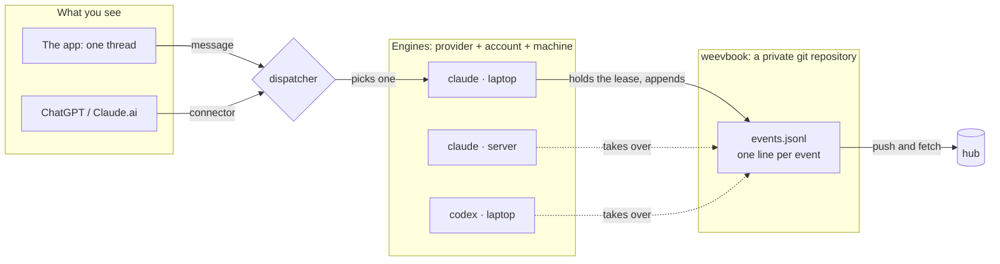

# weevils-owned conversations: the specification

Today a conversation with Claude Code or Codex lives in one file, on one machine, in one provider's format. This
specification describes the next shape: a conversation belongs to you. You start it anywhere, it continues anywhere,
and the app shows one thread.

**Status: steps 1 to 5, behind flags; the vault's steps 1 to 3.** These pages, the sample in [`examples/weevbook`](../../examples/weevbook), the
pure module of the journal ([`server/weevbook/journal.ts`](../../server/weevbook/journal.ts)), the core of the lease,
the turn and the dispatcher (`lease.ts`, `turn.ts`, `dispatch.ts` next to it), a simulator that drives the three
together ([`server/weevbook/sim`](../../server/weevbook/sim), `npm run sim`), the local weevbook
([`server/weevbook`](../../server/weevbook): store, adapters, writer, `weevils weevbook backfill | check | compare`),
and since steps 2 and 3 the sync with a hub (`hub.ts`), the checkpoints of the code (`checkpoint.ts`) and the resume
of a thread on another machine with the same provider (`resume.ts`, `weevils weevbook resume <thread>`, `weevils
weevbook sync status`). The writer is on by default since the vault (`WEEVILS_WEEVBOOK=0` turns it off), and the
first start imports every session of the machine once, in the background; the sync, the checkpoints and the steals are
off unless `WEEVILS_WEEVBOOK_HUB` is set too. Steps 1 to 3 of the vault ([07](07-vault.md#steps)) are built: journals,
attachments and handoffs encrypted and pushed to the person's own GitHub (`weevils weevbook vault setup | push |
restore | status | summary`), on once `vault setup` ran or `WEEVILS_VAULT` names a remote; a machine that joins with
the one line gets the vault in the same exchange, a new machine gets everything back from the recovery code, and
weevboss sets it up, asks the history question and says the summary in its chat. With a vault, each turn's code is
checkpointed, the provider's own lines (slim) and the checkpoints go to the vault too, and `weevils weevbook resume
<thread>` continues a thread on a machine that never ran it, from the vault alone. Since step 4 each thread has its lease on the vault, a machine gone silent or a move the dispatcher chose becomes a proposal weevboss says in one line, and `weevils weevbook move` is the person's direct order ([07](07-vault.md#moving-a-conversation)). On, they write next to the app and change nothing the app shows or does;
a resume happens only when asked. Step 4 is off unless `WEEVILS_THREADS=1`: then the dispatcher runs in weevilsd,
a conversation is one thread whatever engines carried it, the app shows three states and the weevbook page, and the
Codex relay is gone ([06](06-dispatch.md#step-4-the-dispatcher-in-weevilsd), with what making it the default needs). The connector of
step 5 ([`server/connector`](../../server/connector): `/mcp`, its sign-in and the five tools) is off unless
`WEEVILS_CONNECTOR=1`, which weevboss writes and applies at once when the person asks to plug in a chat app; on,
ChatGPT and Claude.ai can send chats to the weevbook ([05](05-connector.md#step-5-the-connector-in-weevilsd)).
Each page ends with
"What exists today", which names the real files the design builds on.

## The idea in one picture

A message arrives. The dispatcher picks one engine. That engine takes the thread's lease, does the turn and appends
what happened to the journal. If the engine stops, another one takes the lease and continues from the journal and
from the last checkpoint of the code.

## Three requirements, in this order when they conflict

1. **Reliable.** No message and no state of the code is lost. Two engines never answer the same thread at once.
2. **Invisible.** Nothing to set up or understand in the app. A thread shows no trace of which engine ran it.
3. **Readable.** Someone curious can understand the system by reading files.

## The pages

| Page | What it settles |
|---|---|
| [01 Thread](01-thread.md) | What a thread is. The journal: every event type and its fields. How a provider's lines become events. |
| [02 Weevbook](02-weevbook.md) | The repository: one folder per thread, what each file is, what is written and what is redacted. |
| [03 Sync and lease](03-sync-and-lease.md) | The hub. One git ref per thread. The lease as git pushes. How `main` is composed. |
| [04 Resume](04-resume.md) | The three rungs of resuming. Checkpoints of the code. The handoff. What happens when a turn fails. |
| [05 Connector](05-connector.md) | The MCP endpoint for chat apps: five tools, their schemas, uploads in parts, sign-in. |
| [06 Dispatch](06-dispatch.md) | The engine table and the decision table that picks an engine, with no model call. |
| [07 Vault](07-vault.md) | Steps 1 to 4 built (journals, attachments and handoffs; the join carries the vault; a new machine from the recovery code; the onboarding in weevboss's chat; slim raw lines in raw repositories, checkpoints as encrypted bundles, a thread resumed from the vault) and step 4 (the lease on the vault, weevboss's proposals, direct orders). Every conversation kept on your own GitHub, encrypted; the history imported at install; moves agreed by the person. |

Decisions and their reasons are in [`docs/adr`](../adr). Each page lists its invariants: numbered statements that
tests check. `THREAD-n` and `BOOK-n` are tested today in
[`server/weevbook/journal.test.ts`](../../server/weevbook/journal.test.ts), one test per number. The lease runs against
real bare repositories in `lease.test.ts`, the turn's state machine and retry rule in `turn.test.ts`, the decision
table row by row in `dispatch.test.ts`, and every invariant a run can show (`SYNC-n`, `RESUME-8`, `DISP-n`, the
journals' `THREAD-n`) is checked after each simulated run in `sim/sim.test.ts`.

## Glossary

One word per concept. These pages never use another word for the same thing.

| Word | Meaning |
|---|---|
| **thread** | One conversation. It has a permanent id of its own. It is what the app shows. |
| **turn** | One request and the work an engine does for it, until the engine stops. |
| **engine** | One provider, signed in to one account, on one machine: `claude:a3f9c1@laptop`. |
| **leg** | A stretch of a thread run by one engine in one provider session. Never shown in the app. |
| **source** | The door content came in by: `weevils` (the app), `claude`, `codex`, `connector`, `import`. |
| **weevbook** | Your private git repository that holds all your threads. The source of truth. |
| **hub** | The git remote of the weevbook: where your machines push and fetch. |
| **lease** | The right to write to one thread, held by one machine at a time. |
| **checkpoint** | The state of the code, saved at the end of a turn. |
| **handoff** | The document (`handoff.md`) that lets an engine of another provider continue a thread. |

Supporting words, used with one meaning too:

| Word | Meaning |
|---|---|
| **journal** | The file `events.jsonl` of a thread. |
| **event** | One line of a journal. |
| **provider** | A coding agent weevils can drive: `claude` (Claude Code) or `codex` (Codex). |
| **account** | One subscription to a provider. Written as a short hash, never as an e-mail. |
| **machine** | One computer that runs weevils, by its weevils id (`laptop`, `server`). |
| **provider session** | The provider's own id for a conversation and the file it keeps for it. |
| **raw** | The lines of a provider session, kept as the provider wrote them. |
| **adapter** | The code that turns one provider's raw lines into events. |
| **rung** | One of the three ways to resume, from lossless to handoff-based. |
| **dispatcher** | The code that picks the engine for a turn. |
| **connector** | The MCP endpoint chat apps use to reach the weevbook. |
| **project** | The group a thread is filed under: usually one repository. |
| **chat** | A conversation inside a chat app (ChatGPT, Claude.ai), before it is a thread. |
| **step** | One tool call of an engine during a turn. |
| **preface** | The first request weevils gives an engine that resumes a thread. Signed, so it is not taken for a message. |

## Constants

Every number in these pages, in one place. They are starting values, to be tuned with the simulator of step 4.

| Constant | Value | Page |
|---|---|---|
| Lease renewal while a turn runs | every 20 s | 03 |
| Lease lifetime after a renewal | 60 s | 03 |
| Unchanged lease observed before a steal | 60 s | 03 |
| Clock grace before a steal | 30 s | 03 |
| The dispatcher reads `working` leases | every 10 s | 03 |
| A dead holder's lease is stolen, at the latest | 130 s after its last renewal (clocks within 30 s) | 03 |
| Lease on the vault: renewal while a turn runs | every 5 min | 07 |
| Lease on the vault: lifetime after a renewal | 10 min | 07 |
| Lease on the vault: unchanged before it counts as silent (then a proposal, never a steal) | 10 min, and 30 s past its lifetime | 07 |
| The machine that serves the app reads the vault's leases | every 2 min while another machine works, every 10 otherwise | 07 |
| A held message handed again to the holder | every 30 s | 03 |
| An engine chosen that has not started the turn | decided again after 30 s | 03 |
| Largest journal line | 1 MiB | 02 |
| Largest raw segment | 16 MiB (a new one is sealed at 1 MiB) | 02 |
| Largest untracked file in a checkpoint | 5 MiB | 04 |
| Largest folder without git that is checkpointed | 200 MiB or 20,000 files | 04 |
| Failures of a turn on `api` or `auth` before it is held | 3 | 04 |
| New threads a machine takes on the hub per round | 50 | 03 |
| A turn's checkpoint is taken when its end is read within | 10 min | 04 |
| Last exchanges given word for word on rung 3 | 24 messages, 20,000 characters | 04 |
| Messages per connector part | 40, each up to 20,000 characters | 05 |
| Quota reading considered fresh | 5 min | 06 |
| Engine considered alive | seen in the last 180 s | 06 |
| Quota: leave at / enter under / return under | 97 % / 85 % / 50 % | 06 |
| Turns finished before going back to the first provider | 2 | 06 |
| Reservation per turn (5-hour window) | 10 points; 20 on a change of account | 06 |
| A reservation ends when the account is read again | over 60 s after it was made | 06 |
| A held turn is looked at again | when the engine table changes, at least every 60 s | 06 |
| A machine writes its `engines.json` | every 60 s | 06 |
| A turn of weevils waiting for an engine is closed (`expired`, `stopped`), unless it waits for room | 1 h after it last moved | 06 |
| The dispatcher stopped longer than this begins a new run (what came before is never placed) | 10 min | 06 |
| `handoff.md` rewritten after a turn ends | 15 s later, threads active in the last 24 h | 04, 06 |
| A new Codex session's file is waited for | 30 s | 06 |

## Open decisions

Not decided here. Each has a recommendation; the owner decides.

| | Decision | Recommendation | Page |
|---|---|---|---|
| D1 | A hub for people without a server: a private GitHub repository created at setup? | Yes, but only together with D2. | [03](03-sync-and-lease.md#open-decisions) |
| D2 | Encrypt the weevbook before it leaves for a hub you do not own? | Yes. It costs reading on GitHub and delta compression. | [03](03-sync-and-lease.md#open-decisions) |
| D3 | Keep the handoff current after every turn, using a small model? | Yes, for threads active in the last 24 h. | [04](04-resume.md#the-handoff) |
| D4 | When several engines can take a turn: same provider first, or spread the quota? | Same provider first. | [06](06-dispatch.md#the-decision-table) |
| D5 | Bring existing provider sessions into the weevbook? | **Decided at step 1: yes**, `weevils weevbook backfill`, through the same adapters: one thread with one leg each, no checkpoint. | [02](02-weevbook.md#step-1-the-local-weevbook) |
| D6 | The name shown in the app for the weevbook page. | Not a specification matter. | — |

## The steps

| Step | What | Done when |
|---|---|---|
| 0 | This specification, the sample weevbook, the invariant tests. No change in the app. | The owner has read and approved it. |
| 1 | The weevbook is written locally, next to the app, for every provider session ("shadow"). | `weevils weevbook backfill` then `weevils weevbook compare` over every session of a machine: no message missing or altered (the owner chose this replay over 7 days of observation). Then the writer runs in shadow. |
| 2 | Sync to the hub and checkpoints. | A machine switched off mid-work: the hub has everything pushed up to the last 20 seconds. |
| 3 | Resume on another machine, same provider. | Automated: start on one machine, cut it, resume on the other, same code. |
| 4 | The thread becomes the unit in the app; handoff between providers; the dispatcher. | The simulator of the reference scenario is green over thousands of runs. (The simulator exists: `npm run sim -- --seeds 20000`.) |
| 5 | The connector and the weevbook page. | A chat is sent from ChatGPT and Claude.ai, then continued by an engine. |
| 6 | Setup by talking to weevboss, with no screen to fill in. | A new user connects an account, a second machine and the connector by talking. |
