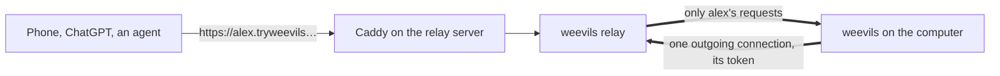

# Stable address

A weevils on a computer (no domain of its own) gets a public address that never changes:
`https://<name>.tryweevils.scarville.tech`. The installed app, the login link and a chat app's connector
(`https://<name>.tryweevils.scarville.tech/mcp`, docs/spec/05-connector.md) keep working after a restart, a network
change or a night asleep. A weevils with its own domain, Tailscale or a proxy (`--domain`, `--url`) keeps its own
address and never gets one unless asked.



## How it works

- **Claiming a name.** The setup page's install (`get/bootstrap.sh`, `--handle=<name>`) asks weevils for one
  (`weevils address claim <name>`); without a name, one from the user's name, with four random characters when it is
  taken. The relay answers with a token, shown once and kept in the config (`WEEVILS_LINK_HANDLE`,
  `WEEVILS_LINK_TOKEN`, 0600); the relay keeps only its SHA-256 hash. A computer still on a Cloudflare quick tunnel
  (an install from before) moves to a stable address by itself at its next start, tells the phone (a notification
  with the new login link), and stops its old tunnel service. `WEEVILS_LINK=off` keeps it on the tunnel.
- **Connecting.** weevils opens one outgoing HTTPS connection to the relay (`GET /v1/connect`, `Upgrade:
  weevils-link`, the name and the token). The relay answers `101` and the connection becomes HTTP/2 the other way
  round: each request for `<name>.tryweevils.scarville.tech` is a stream on it, which weevils replays to its own port
  on `127.0.0.1`; a WebSocket is a stream of raw bytes. Server-sent events stream as they come. Nothing opens on the
  computer or the router. Both ends ping every 20–25 s: a laptop that went to sleep is seen gone within a minute,
  and weevils reconnects by itself (1 s, then up to 30 s between tries). A newer connection for a name replaces the
  older one.
- **Trust.** A request through the relay always carries `X-Forwarded-For` and the public `Host`, so weevils never
  takes it for the machine itself (server/http.ts `isLocal`); `X-Weevils-Local` from outside is dropped. The access
  code is asked as from any visitor. The relay only forwards a name's requests to the connection that showed that
  name's token: there is no other way through it.
- **Giving it back.** `weevils address release` frees the name (it stops answering at once) and turns the automatic
  claim off. The relay frees by itself a name never connected within 2 days of its claim, or not seen for 180 days.
  Its operator revokes a name with `node server/link-relay.ts revoke <name>`: the connection closes within seconds
  and weevils stops trying (`weevils address` says `revoked`).
- **What the relay sees.** Like any HTTPS proxy (Cloudflare's quick tunnel included) it decrypts what it passes on.
  It logs when a name connects or leaves, never an address, a request or a body. Each name gets its own certificate
  (Caddy's on-demand TLS), so names appear in public certificate logs.

`weevils address` shows the address and its state (`online`, `connecting`, `offline`, `revoked`); `GET /api/address`
gives the same to the app.

## Running a relay

The official one runs on Scarville's server. Anyone can run their own and point their weevils at it with
`WEEVILS_LINK_RELAY=https://relay.<domain>` (the names are then `<name>.<domain>`).

1. DNS: `*.<domain>` (and `relay.<domain>`) to the server.
2. The relay, as a user service (port 4183, 127.0.0.1 only):
   ```ini
   [Service]
   ExecStart=/usr/bin/env node %h/weevils/server/link-relay.ts serve --port 4183 --domain <domain> --data %h/.local/share/weevils-relay/handles.json
   Restart=always
   ```
   Restart it only on purpose: every weevils reconnects within seconds, but the requests under way are cut.
3. Caddy: in the global options, `on_demand_tls { ask http://127.0.0.1:4183/ask }` (the relay says yes only for
   claimed names and `relay.<domain>`), then:
   ```
   *.<domain> {
   	tls {
   		on_demand
   	}
   	reverse_proxy 127.0.0.1:4183 {
   		flush_interval -1
   	}
   }
   ```
4. `node server/link-relay.ts list` shows the names; `revoke <name>` takes one back.

Limits: 10 claims per address per day, 5,000 names (`serve` options in server/link-relay.ts). Let's Encrypt issues
50 certificates a week per registered domain; past that Caddy falls back to ZeroSSL.
